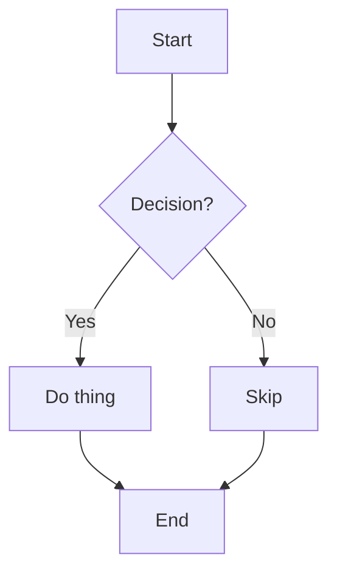
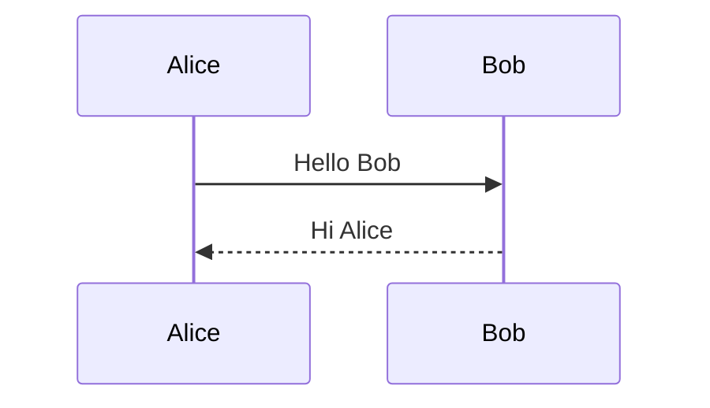

# Manual Test Checklist

## Current daily-use acceptance — 0.67.0 (2026-11-14)

The user postponed the genuine 20–30 minute writing session and heading/table
VoiceOver check on 2026-11-14. Keep them pending; do not repeatedly request the
basic 0.63.0 input and 0.63.1 VoiceOver checks that already passed in their scope.
The current controlled harness verifies Chromium composition in headings, plain/
bold/combined-emphasis text, lists and table cells; cancellation, exact history,
backup exclusion of preedit and source cancellation remain separate from physical
candidate input. AX checks verify title levels/table roles and text in both modes,
plus keyboard access/return for linked-file controls, not actual spoken feedback.

When convenient, complete only these remaining human checks on disposable content:

1. Write normally for 20–30 minutes using your usual Chinese input method. Include
   candidate commit/cancel, selection changes, Undo/Redo, Source return and saving.
   Quit and reopen; restore the draft and confirm the last intended text. Pass:
   no missing/duplicated text or stranded candidate/focus; record actual duration
   and input method. Note noticeable stalls rather than guessing their cause.
2. Enable VoiceOver with Command+F5 (or Fn+Command+F5). In a disposable article,
   read an actual heading and a table header/data cell, then use Details → Disk
   file controls and Escape. Pass: roles/content/control names are understandable
   and focus returns. Report which part was heard; an AX tree is not this result.

Unperformed checks remain NOT TESTED. No new manual PASS or public-release signoff
is established by this automation group. Existing external/sync save restrictions
and the separately deferred paid signing/notarization work are unchanged.

## Everyday file workflow — 0.67.0

Use a disposable local `.md`. Open it, then Details → Check disk changes: the
path and timestamp should describe this file. Open disk version must leave the
previous original open. Create an editing copy, change text, save, Undo and Redo;
file status should distinguish unsaved/saved text independently from draft backup.

Change the file in another editor. Explicitly check disk again: saving pauses and
current text/history remain. Open disk version in a separate read-only session;
return to the retained draft and export under a new name. The external contents
must remain unchanged. Move the newly exported synthetic file away and recheck:
missing-file feedback must preserve writing and allow Save As with a fresh name.
A later successful check must not silently resume an already stopped save.
Keyboard/VoiceOver checks of these new controls are NOT TESTED by a human yet.

## Common inline compatibility — 0.66.0

Use a disposable article with headings, combined bold/italic text, soft-wrapped
plain paragraphs, task lists, quotes, code, tables, links and image references.
Edit within/cross emphasis; toggle compatible emphasis on selected text; Enter
continues paragraphs/headings, quote rows and list items. Select across plain soft
source lines, replace or delete their displayed space, and split inside a line.
Undo/Redo must restore exact source; unaffected code/table/link/image content stays
unchanged. Save/reopen and quit/restore the draft. Native cross-frame/line IME
remains guarded; physical-input and VoiceOver acceptance are NOT TESTED.

## Formatted long-document writing — 0.65.1

On a disposable long article, type within a formatted paragraph near the start,
a heading in the middle, and a paragraph near the end. Check Undo/Redo, Source
return, find, save/reopen and quit/recovery without lost text or changed formatting.
Physical IME and VoiceOver results remain pending; committed-text automation is
separate. The broader 20–30 minute human writing check remains pending.

## Mixed-format writing — 0.65.0

Select across ordinary/bold/italic/code/link text in one supported text block.
Type replacement text, continue typing, Undo/Redo, save and reopen. The first
selected text format should carry to inserted text; surviving link URLs/titles
stay intact. Repeat using Find Current/All. Unsupported structural changes must
retain source and show refusal. Genuine IME/VoiceOver checks remain NOT TESTED.


## Repeated document sessions — 0.64.1

On disposable files, open two documents, edit and close one, then continue
writing in the other. Confirm notices belong to the current document. Close the
last document, reopen and restore its draft; text should be intact and old receipt
text should not remain in the empty workspace. Human check remains NOT TESTED.


## Find and replace — 0.64.0

In a disposable editing copy use ⌘F, search repeated Chinese/English text,
replace current and then all matches. Undo each action in one step, Redo,
close search with Escape and continue typing. Check case sensitivity, empty
replacement, and a cross-bold match (supported starting in 0.65.0). During genuine
candidate input in either field, Enter/Escape should belong to the input method.
Check controls with VoiceOver when convenient. These human checks are NOT TESTED.


## Current acceptance status — 0.63.2 stability candidate (2026-11-09)

The 0.63.1 acceptance baseline has user-reported PASS for the supplied basic
VoiceOver/focus check. The three genuine-input workflows passed on 0.63.0 with
built-in Pinyin, WeChat Input and iFlytek Input. Do not repeat those checks solely
because a new development batch starts. Dated PENDING/FAIL entries below remain
historical evidence and are superseded only for the exact repeated scenarios.

The user will do the 20–30 minute real-writing session later. Heading/table-cell
VoiceOver checks are also NOT TESTED. Automated long-writing runs do not replace
these results. The 0.63.2 candidate changes only two Unicode-validation hotspots;
use the next genuine session to report any noticeable pauses or text problems.
Paid signing/notarization and formal distribution remain deferred.

## Keyboard accessibility — original 0.63.0 checklist

Controlled Electron verifies region/toolbar navigation, modal focus confinement
and return, light/dark palette pairs and composition focus retention. It does not
exercise VoiceOver or a physical Chinese input method. The current scoped human
results are summarized above; this automation does not clear historical failures.

On a disposable article, use F6 / Shift+F6 through the regions and Option+F10 into
formatting (Fn may be needed). Tab leaves each toolbar; arrow keys/Home/End move
within it. Confirm visible focus, the narrow sidebar's Escape return, reading
settings' modal Tab cycle and source-return focus. During real Chinese preedit,
these region shortcuts must not commit text or strand the caret.

With VoiceOver enabled, check document/editor names and reading order, selected
format states, toolbar buttons and dialog titles. Status should remain meaningful
without repeating unchanged messages. Record OS, input method and observed result;
do not promote automated DOM role checks to a screen-reader PASS.

Installation/update/rollback steps are in [the installation guide](install.md).
Keep the previous bundle and records; testing a downgrade must not discard drafts.


## Practical capacity — 0.61.0 (manual acceptance pending)

Use a disposable article and local PNG/JPEGs. Open a longer article, create a
copy, edit ordinary paragraphs and source, Undo/Redo, insert an image over 1 MiB,
then export, reopen, save an edit and restart/recover. Compare text, image display
and the original BOM/newlines. Keep Markdown and exported image sidecars together.
Check real Chinese IME and sustained typing separately; controlled test input is
not native acceptance. At extreme document length, record visible pauses.

Limits: 2 MiB / 524,288 UTF-16 units; 16 images / 4 MiB each / 16 MiB and 32 million
pixels total. Over-limit input must leave existing content intact and must not
claim a successful backup/export. Whole-source replacements can reduce Undo depth
under the 8 MiB document-history budget. Older Apps can reject these larger drafts;
retain the new bundle/records and export needed work before any rollback.

## Bound-file save — 0.60.0 (manual acceptance pending)

Use a disposable local Markdown file in a supported directory. Open it, choose
编辑副本, make an edit and wait for backup. Cancel the first 保存 prompt and check
that nothing changed; then accept it. Confirm the disk content and saved message.
Continue editing: the previous success remains visible while the new edit is
unsaved. Save again, then use Undo/Redo and verify the saved-state distinction.

While the draft is open, edit the disposable original externally. Saving must
report conflict and retain both the local draft and external content; it must not
retry. In 草稿 → 保存版本, inspect the previous/draft versions. Restart and restore
the draft: text returns but original-write authority does not. Native dialog
interaction and real Chinese IME must be recorded separately from automated checks.
Do not test races against personal documents.

## Complete source editing — 0.59.0

Automated checks cover raw edits, history and IPC fences, mixed line endings,
original-file protection, source/rich editing, backup/restart and new-file export.
Controlled composition events are not native IME acceptance.

Optional focused acceptance on a disposable document:

1. Open an original, create an editing copy, then open **源码**. Change a heading
   and a YAML/HTML region, search with ⌘F, and try local Undo/Redo.
2. Choose **返回** with unapplied edits: **继续编辑** must retain the text;
   **放弃修改** must leave the document unchanged. Unapplied text is not backed up.
3. Choose **应用并返回**; verify the visual result and document Undo/Redo.
   Unsupported blocks remain protected visually, without changing their source.
4. Wait for backup, restart/recover, then export a new file. The edits must remain;
   the original and earlier exports must not change. Existing save limits apply.
5. Native Chinese IME: type, select a candidate, cancel composition and switch
   views. Record this separately; previous historical FAIL/NOT VERIFIED is not
   cleared by automated checks or prior limited basic passes.


## Save subfolders — 0.58.0 installed local WIP

Automated evidence: 121 targeted Node checks and one Pro Electron workflow pass.
Native dialogs in that GUI regression are controlled; physical picker use and
comprehensive native IME are not inferred from these results.

Optional next real-use checks, without overwriting an existing target:

1. Edit a copy, then choose a new filename in an ordinary local subfolder of
   `~/Liyunhui` or `~/Downloads`. Confirm the displayed receipt path and reopen it.
2. Cancel a later export, or choose the existing filename. The draft, history and
   previous confirmed receipt must remain; no existing file changes.
3. Choose an unsupported/synced/hidden location. The App should clearly report
   refusal and retain writing. No permission changes or automatic retry occur.

Earlier native IME NOT VERIFIED and historical failures remain as recorded below.

## Finder opening — 0.57.0 (2026-11-07)

Automated evidence: 109 focused Node checks, three Pro Electron workflows and
actual-package macOS cold/warm/repeated LaunchServices opens PASS. The unchanged
file is reused, active draft/history survives switching, composing/modal requests
wait for explicit completion, changed/replaced files and unsupported inputs are
refused. Private draft/recent records were preserved and recovered exactly.
No default file handler was changed; generated composition events do not establish
native IME acceptance. Earlier limited human 0.56.1 experience remains applicable
only to its recorded scope; historical native failures are not automatically closed.

Optional focused human acceptance on the installed 0.57.0 (not yet reported):

- [ ] Right-click a disposable `.md` → Open With → Markdown, once with the App
  closed and once running. Correct original opens; an already open unchanged file
  returns to its existing row. No original file is modified.
- [ ] With a draft being edited, request another file from Finder. The draft stays
  in the sidebar with its text and history. During real Chinese composition the
  request waits; finish input, then use **打开文件**. Record the input method/result.
- [ ] If desired, use Finder Get Info → Open with → Markdown → Change All, then
  double-click a disposable `.md`. This is the user's optional system preference,
  not a setting applied by the installer or a prerequisite for Open With.

Files still need to be accessible regular UTF-8 `.md` within current limits.
Writable-source, wider save folders, safe original-file saving and larger image/
document capacity remain phase 2 development, not acceptance implied by Finder.


## Current combined acceptance — installed 0.56.1 (2026-11-07)

**Human result: LIMITED BASIC PASS (user-reported, 2026-11-07).** The user reported:
“我在APP里做了简单的测试，看着基本没问题，三项基本通过。” This covers the
three requested experience areas: basic Chinese input/history, image export/reopen,
and long-document outline/source navigation. No new problem was reported.

This is a simple experience check, not evidence that every detailed substep below,
every input method or all edge cases were exercised. The exact IME configuration
was not supplied. Basic input has positive human evidence; comprehensive native
IME acceptance remains NOT VERIFIED. Historical manual/formal failures remain
recorded until their specific reproductions are retested. Full CI, SEC-01 and
release gates are unchanged. Do not ask the user to repeat these three basic checks
without a new regression or a specific uncovered risk.

Older dated checklists below are history. For future targeted checks, use a scratch article;
a synthetic long article and small PNG are prepared in control-checkout evidence
`.local/verification/broader-writing-acceptance-3kh_j2q5/manual-fixture/`.
No need to type the long fixture or manually force queue saturation.

1. Open the scratch article, create an editing copy and use macOS Chinese Pinyin
   in its first paragraph. Choose a candidate, cancel a second preedit, finish
   two sentences, then Undo/Redo and continue typing. Expected: exact completed
   text without lost/duplicated characters, a stable caret, and no persistent
   disabled state after composition ends. Synthetic Unicode insertion is not
   evidence for this native check.
2. Use the image button to choose the prepared PNG (or a small disposable PNG/JPEG).
   Confirm preview, description and Undo/Redo. Export to a supported local folder
   with a fresh filename, then use the export receipt to reopen. Expected: both
   text and image match; original files stay unchanged. Keep Markdown and its
   image sidecar together. Subsequent copy edits must not change the exported file.
3. Filter the outline for `Chapter 160`, press Enter, view **源码**, then Escape
   back and continue editing. Expected: correct target, readonly source, retained
   article position, and normal later editing/Undo. Report any unexpected jump,
   lag or layout obstruction during ordinary use.

The user has returned a basic pass for all three areas. Future failures should
identify the exact step; a limited pass does not automatically clear historical
IME failures, full CI or release gates. If creation is partial/unknown or input
pauses, retain the window/evidence and needed text; do not blindly retry or delete.
The new combined Pro regression passes controlled text/history, image export and
reopen, source navigation and restart recovery. Automation and the user report
are distinct evidence. The installed runtime and version are unchanged.

## Input saturation correction — 0.56.1 (2026-11-07)

Automated verification passes; human acceptance is pending. No user needs to
manually force 65 queued edits. If the pause notice appears during normal use,
confirm it persists, copy needed text from the retained Markdown, and explicitly
acknowledge before resuming. Later accepted replies must not hide it. Pending
operations must settle first; switching documents must preserve the record.
Check light/dark readability. The record is window-local, not a backup; do not
close before retaining needed text. Controlled composition tests do not establish
native Chinese IME acceptance or remove historical manual/formal FAIL.


## Long documents / read-only source — 0.56.0 installed WIP (2026-11-07)

Pending human acceptance on the installed 0.56.0 App. Packaged paced typing,
outline/source, history/recovery and startup passed controlled automation.
Zero-delay automated input exceeded the 64-edit queue and lost rejected keys;
this historical FAILED case remains recorded. 0.56.1 adds bounded pause/recovery;
it does not promise unlimited input throughput. Controlled results do not replace these checks:

1. Open a long article, filter an outline title and press Enter to jump; clear
   with Escape. Duplicate headings remain separate targets. Scroll and confirm
   the active heading follows the article; filtering does not change the body.
2. Open **源码**. Confirm heading markers, unsupported syntax and original line
   endings/BOM description. Select/copy text, toggle wrapping, press Escape;
   return to the same article position and continue editing/Undo/Redo.
3. While Chinese input is composing, the source trigger must not steal focus;
   finish input and retry. This is still native IME NOT VERIFIED, not a cleared
   historical manual/formal FAIL.
4. Switch documents and inspect source again: no prior document text. Check a
   narrow window and light/dark appearance. Source is read-only, with no original
   overwrite; copy selection is not a byte-exact backup. Existing drafts/export
   retain their original meanings.


## Local images — 0.55.0 installed local WIP (2026-11-06)

Human acceptance is pending; these features are included in installed 0.56.0. The actual 0.55.0 package passed
macOS native PNG selection through computer-use automation, preview/history,
attachment export, readonly reopening and restart recovery. Save/close choices
in that package test were controlled; earlier source E2E also covers JPEG.
Native IME is NOT VERIFIED; historical formal/manual FAIL remains.

1. In a scratch draft, use image → 选择本地图片 with a small PNG/JPEG. Check the
   native picker, cancel, description, preview, Enter, Undo/Redo and normal typing.
2. Export to a supported local folder with a new name. Keep the Markdown and
   image sidecars together; reopen and check both images and text. Original image
   and original Markdown must be unchanged. Later edits stay in the draft.
3. Wait for confirmed draft backup, close and recover. Check images and text;
   old Undo history and export authority must not return. Image drafts need 0.55.0.
4. Unsupported/oversize images and missing or replaced attachments must not appear
   as confirmed exports. Preserve any partial/unknown result; do not retry or delete
   it blindly. Check narrow/dark layout and real IME without treating automation
   as native input-method acceptance.

## Image references — 0.54.0 installed candidate (2026-11-06)

Human acceptance is pending. The local app at `~/Applications/Markdown.app` is
now 0.54.0; actual-package combined writing/export/recovery and installed startup
passed controlled automation. Try these checks with the task/table steps below in
one scratch draft. Do not treat the card as a loaded image. Native IME remains
NOT VERIFIED and historical formal/manual FAIL remains open.

1. In a scratch paragraph, use the image button with a relative address; select
   the resulting card to edit its description/address. Cancel preserves it.
   Enter continues in prose; remove and Undo/Redo restore the exact reference.
2. Check light/dark and narrow layout. Invalid script/file/data addresses leave
   panel input and body intact; composing input must not be committed prematurely.
3. Export a new `.md`, reopen readonly, then restart and recover the draft.
   Reference text should match; original files remain unchanged. No preview or
   attachment copying is promised; check relative paths when choosing a new folder.

## Basic tables — 0.53.0 local candidate (2026-11-06)

Focused human acceptance is pending; automated evidence is in the phase record.
The mixed list/table workflow also passed scripted Pro verification. For this
acceptance, combine the list and table steps in one scratch draft, switch away
and back, and check that later edits remain separate from the exported snapshot.
Native Chinese IME remains NOT VERIFIED; earlier manual/formal FAIL is retained.

1. New scratch draft: click the table button; replace header text, fill empty
   cells, Tab/Shift+Tab between cells and Enter down a column. At the last row,
   advancing appends a blank row; Cmd+Enter returns to ordinary prose.
2. Use +/− row and column controls. Undo/Redo should restore content and structure;
   the header row/final column cannot be removed. Try one-line Chinese/emoji paste
   inside one cell; multiline/cross-cell input must be refused without text loss.
3. Export to a new Markdown file, reopen read-only, then restart and restore the
   draft. Check cell contents/order/alignment. The original must remain unchanged.

Bounds: plain outer-pipe rectangular tables, 8 columns / 32 rows (header included),
three-hyphen separators; no nested marks, links, escaped pipes, merged cells or
spreadsheet paste. Test native IME separately; synthetic strings are not native QA.

## Task and nested lists — installed 0.52.0 candidate (2026-11-06)

Installed at `~/Applications/Markdown.app`; human acceptance remains pending.
Native Chinese IME remains NOT VERIFIED and the
historical formal/manual FAIL is not cleared by synthetic input.

1. Create a scratch draft; type `- [ ] ` and a task, toggle its checkbox, then
   Undo/Redo. Text and checked state must both match each revision.
2. Enter another task, Tab to nest it, Enter a sibling, Shift+Tab to lift it.
   Try ordinary and ordered items, including a subtree with children. Nested
   empty tasks lift; a final top-level empty item exits to normal prose.
3. Select text across two same-level leaf items; replace/paste one line, delete,
   and Undo/Redo. Cross-level/subtree ranges must leave all text intact on refusal.
4. Export once to a supported fresh file, reopen readonly, exit/restart and
   restore the draft. Compare text, nesting, checked states; the original and
   exported snapshot must not change after later draft edits.
5. Check checkbox alignment/focus in the accepted light/dark workspace. During
   actual IME composition, checkbox/structure operations must not write preedit.

Limits: six levels/32 items; no loose or multiline item bodies, cross-level range
replacement, multiline list paste or bulk structured-list conversion. Type text
before indenting an empty ordinary bullet; ambiguous CommonMark boundaries remain
refused. Controlled Pro tests cover the above supported paths but do not replace
this native interaction acceptance.

## Draft naming / export names — installed 0.51.0 WIP (2026-11-06)

Automated: 130 targeted Node checks and one two-start Pro Electron workflow PASS;
normal/narrow screenshots reviewed. Dialog choices and composition events are
controlled. Air blocked on launch-time lock detection before GUI. The installed
app is now 0.51.0. Bounded package naming cancel/invalid-input checks and installed
startup/recent-panel checks pass; existing private records were unchanged. This
is not a human/native-IME PASS or a full packaged writing/recovery acceptance.

Optionally check one short writing session in the installed app:

- In an independent draft, click the title → **重命名草稿…**; cancel once, then
  confirm a short Chinese/English name. Title/sidebar update; text and Undo remain.
- Export to a supported folder: the suggested name matches and ends in `.md`.
  A different native filename only names the new file; an existing target is refused.
- Quit after backup, restart and resume: the draft name/body remain. Renaming does
  not rename the original or an earlier export, and recovery does not restore Undo
  or export receipts. A named empty draft is also recoverable.

Original-file overwrite remains prohibited. Native IME and the historical manual
FAIL remain separate acceptance gaps; no repeated real-document saves are needed.

## Recent documents / resume writing — 0.50.0 candidate (2026-11-06)

Automated: 148 targeted Node checks; one isolated Electron workflow on both Pro
and Air, each with three clean starts/exits. Normal and narrow screenshots were
reviewed. Dialog choices are controlled; native IME is NOT VERIFIED. The installed
app now includes this workflow in 0.51.0; five recent Node regressions were
rechecked on the combined candidate. These human checks remain pending:

- Open a disposable `.md`, edit an independent copy, wait for backup and restart.
  Welcome should offer the draft under **继续写作** and the file under **最近文档**.
- Resume the draft and continue writing; use **最近文档** to reopen the original
  read-only. Draft content and original content remain separate.
- Modify the disposable file externally: its recent entry should require **打开…**
  again, retaining the current document. Clear the list and restart: history stays
  empty, while the file and recoverable draft remain.

No human PASS is implied. Clearing the list is not secure erasure of retained
catalog generations; no existing-file overwrite or save-destination expansion.
  
Use this checklist before sharing the app with another person.  

## Common-authoring closeout — installed 0.49.0 (2026-11-06)

Automated: 351 targeted Node cases, five source Electron workflows, one packaged
workflow and installed startup PASS. This adds no human/native-IME PASS. The local
app is updated; the previous bundle is recoverably retained.

For a short optional experience, write one article using `# `, ordinary paragraphs,
bold/italic, a link, a flat list, `> ` and a basic fenced code block. Continue typing
immediately after Enter. Export a new file, reopen it, then quit and recover the
draft: content should match, while old Undo history and export authority do not
return. Originals remain unchanged; later draft edits do not update the export.
Native Chinese composition and historical failures still need separate acceptance.

## Quote/code workflow — 0.49.0 WIP candidate (2026-11-06)

Automated: 383 targeted Node and five Pro source Electron workflows PASS. No
new human/native-IME or installed-app acceptance is claimed. After safe installation:

- In a new draft type `>` and Space, write two plain quote paragraphs, then
  Enter on the last empty quote paragraph to continue ordinary prose.
- Type three backticks plus optional `js`, then Enter. Type code, use Enter/Tab,
  paste multiple lines with blank lines, Undo/Redo, and Cmd+Enter to continue prose.
- Edit a supported loaded quote/code block, export a new file, reopen and compare;
  original content must remain unchanged. Complex blocks stay read-only.

Quotes require explicit `> ` lines with `> ` blank separators; lazy/wrapped/nested
quotes stay protected. Splitting marked quote paragraphs is not supported; use
Cmd+Enter to exit. Basic fences must be closed, unindented, with a simple optional
language and no metadata. Existing safety/IME/release limitations remain.

## Link workflow — 0.48.0 WIP candidate (2026-11-05)

Automated: 399 targeted Node cases and three controlled source Electron workflows
PASS. The source candidate is not yet the running installed app (0.46.0).
No human/native-IME pass is claimed. Optional experience after a safe installation:

- Select ordinary text, press Cmd+K, enter an address and apply. With a caret in
  a simple link, edit its text/address or cancel; cancellation retains the document.
- Use **取消链接** to keep text without the link; Undo/Redo restores each operation.
  Clicking a link edits it without opening a browser.
- Export a new file and reopen: link text/address match, original stays unchanged.

Nested formatting, cross-link ranges and reference links remain protected.
Controlled composition events do not replace native IME acceptance; historical
manual failures and existing release limitations are not globally cleared.

## Italic editing — 0.44.0 WIP candidate (2026-11-05)

Automated: 323 focused Node, four controlled source Electron workflows, one
packaged workflow and installed welcome startup PASS. No human or
native-IME pass is claimed. Optional short experience on a synthetic document:

- Select plain text, click **I** or press Cmd+I; select the entire italic phrase
  and repeat to remove it. Reverse selection and Undo/Redo should preserve text.
- Type in italic text; Enter splits and Backspace rejoins a supported paragraph
  or simple list item. Delete a whole italic paragraph, then type again.
- Select text already bold and request italic: explicitly refuse nested marks,
  keep content and continue with a plain selection.
- Export a new file and reopen it: italic appears correctly, original unchanged.

Native IME, full physical QA and historical acceptance limits remain separate.

## Adjacent list-item selections — installed 0.43.0 WIP candidate (2026-11-05)

301 focused Node, four controlled source Electron workflows and one packaged
editing/export/reopen/recovery workflow plus installed welcome startup PASS.
Native IME and full physical/manual acceptance remain NOT VERIFIED. Optional check:

- In a synthetic simple bullet or numbered list, select from midway through one
  item into a later item, including bold text; type, paste one line or delete.
  Unselected edges merge into one item. Undo/Redo restores each complete operation.
- Select all text across the list and press Backspace/Delete, then type again.
  One empty list item remains. Undo restores the original items and formatting.
- Select into a protected code block or paste multiple lines across list items:
  refuse the entire operation and retain text. Make a safe selection and continue.
- Switch original/copy, export a new file and reopen; original bytes stay unchanged.

This supersedes the 0.42.0 cross-item refusal only within one simple flat list.
Different lists, nested/task/loose lists and ambiguous source syntax remain protected.
Controlled Chinese clipboard text and stubbed dialogs do not establish native IME.

## Single list-item selection editing — installed 0.42.0 WIP candidate (2026-11-05)

Automated: 267 focused Node, four controlled source Electron workflows and one
packaged editing/export/reopen/recovery workflow plus installed welcome PASS.
No new human/native-IME acceptance is claimed. Optional brief experience:

- In a synthetic list item such as `- Alpha **bold** tail`, select across plain
  and bold text in either direction; type or paste one line, then Undo/Redo.
- Delete all item text, type again, and Undo. The empty item accepts plain text;
  Undo restores the original text and formatting. Enter/Backspace still work.
- Select across two list items or paste multiple lines into an item: reject the
  complete operation, retain content, and allow the next supported edit.
- Export to a new filename and reopen. The original stays unchanged and read-only.

Mixed-format composition replacement, nested/task/loose lists and ambiguous
Markdown delimiters remain protected. Controlled Chinese clipboard text does not
verify native macOS IME; historical formal/manual failures remain scoped/open.

## Paragraph/list boundaries — installed 0.41.0 WIP (2026-11-05)

Automated: 237 distinct focused Node, four controlled source Electron workflows,
one packaged keyboard/export/reopen/recovery workflow and installed startup PASS.
This is not human/native-IME acceptance. Optional short experience:

- In an ordinary paragraph containing bold, press Enter inside the bold text,
  then Backspace at the next paragraph's beginning; Undo/Redo restores each step.
- Repeat inside a simple bullet/numbered list. At the first item's beginning,
  Backspace returns it to normal text while preserving the remaining items.
- Start a list from an empty document with the format selector; Enter on an empty
  first/last item exits. A middle empty item's Enter is refused; typing still works.
- Export a new file and reopen it. Original files stay unchanged and read-only.

The historical 0.40.0 split/join restriction below is superseded only for this
supported paragraph/simple-list scope. Complete physical QA remains pending.

## Plain/bold selection editing — installed 0.40.0 WIP (2026-11-05)

Automated: 216 focused Node, three controlled source Electron workflows, one
packaged mixed-range/export/reopen/recovery workflow and installed welcome PASS.
The 0.39.0 checkpoint/rollback is retained. Native dialogs were stubbed, Chinese
text was controlled input, and native IME/full physical acceptance is NOT VERIFIED.
No new user manual acceptance is claimed. Optional brief experience:

- Open a synthetic paragraph such as `Alpha **bold** omega.` and edit a copy.
  Select from plain text into bold, then in the opposite direction; type or paste
  one line. New text follows the format of the selected text's start.
- Delete a complete bold span, Undo/Redo, and continue typing at the boundary.
  Confirm one Undo restores the complete original operation and formatting.
- Try multiline paste into the mixed selection or select across a code block:
  the edit must be refused with existing content retained; a safe edit still works.
- Export a new file and reopen it; the original stays read-only and unchanged.

The historical 0.39.0 cross-format refusal below is superseded only for this new
same-paragraph plain/bold scope. Mixed-format paragraph split/join is still limited.

## Ordinary paragraph range editing — installed 0.39.0 WIP (2026-11-05)

205 targeted Node / three final controlled Electron passes are reused; one new
packaged range/export/reopen/recovery regression and installed welcome startup
pass. All 528 installed bundle entries match; 0.38.0 is retained for rollback.
Native dialog choices in the packaged regression were stubbed; physical range
input and native close Cancel are not newly accepted. Optional bounded check:
select from the middle of one plain paragraph into the next, replace/delete,
Undo/Redo, then type and split/join. Try multiline plain-text paste over the same
range. A selection across a heading, bold span or code block must be rejected
without preventing the next safe edit. Original files stay read-only.
Native Chinese composition is not covered by these controlled input checks.

## Individual document close — installed follow-up (2026-11-05)

0.38.0 is now installed and byte-verified, with a preserved 0.37.0 rollback.
Ordinary launch, a real Cmd+W prompt and a restore action were observed on a
synthetic draft. A Cancel click returned a stale-window error; the next observed
state does not establish Cancel semantics. Exact restored-body verification also
remains incomplete. Native Cancel/full installed-flow acceptance is NOT VERIFIED;
do not replace that gap with the controlled close E2E passes. The earlier
historical record below describes the pre-install attempt, not current installation.

## Individual document close — source candidate (2026-11-04)

Automated: main/session/preload guards, cancel/history retention, verified draft
recovery, empty welcome/find/outline reset, backup-directory replacement refusal,
continued editing/Undo after refusal and unchanged original bytes. The native
confirmation choice is stubbed in E2E (five affected workflows passed on
Electron 43.8.7). A separate native-close attempt could not operate the
dialog because the GUI control pipe failed to start; its wait timed out.
Real close confirmation and native IME remain NOT VERIFIED. The unsigned
0.38.0 package is byte-checked but has not replaced installed 0.37.0 or been
accepted through an ordinary packaged GUI launch. Historical formal/manual
FAIL is not cleared.

When accepting a build containing this candidate, use a disposable document:

1. Open an original and edit a copy. Cmd+W → Cancel must keep text and Undo/Redo.
2. Cmd+W → Keep draft and close should select the remaining document. Restore
   from 草稿 and check the text; previous Undo/export authority is not restored.
3. Close the final read-only document: welcome remains, window stays open.
4. During real Chinese composition, closure must wait for confirmed/cancelled
   input; after completion it should work. Cmd+Shift+W retains the window guard.

No request to repeat unrelated manual QA. Existing originals/exports must remain
unchanged; unknown file-creation or backup results require retaining the window.

## Current Document application — 0.37.0 local WIP (2026-11-04)

- **Observed by Codex:** ordinary macOS launch of `~/Applications/Markdown.app`
  displays the current Document welcome/workspace without a terminal launcher.
- **Controlled packaged E2E PASS:** open synthetic original read-only, edit copy,
  export exact new bytes, reject duplicate target, reopen read-only, restart and
  recover confirmed draft with empty old Undo/authority. Original hash unchanged.
- **NOT VERIFIED here:** native Chinese IME, native save-dialog interaction and
  native Finder display. Scripted choices/calls do not substitute for these.
- Preserve earlier manual/formal failures and public-release gates. No new request
  for the user to repeat unrelated QA; current scope is installation/entry closeout.
- Installation does not enable overwrite or arbitrary destinations. Backups remain
  in `Markdown Vault Document Drafts`; use the app's archive/restore actions.

The dated lists below concern older milestones. Their “current” wording is
historical and is not acceptance of this installed Document build.

Current milestone status lives in the
[frozen acceptance record](roadmap.md#finite-acceptance-record). On 2026-09-09
the user reported the requested physical Undo/Redo and Chinese IME checks as
passing. This does not mark the other native checks below complete; older
unchecked lists remain historical until their results are explicitly recorded.

**A6 candidate, 2026-09-09:** [Fix and evidence](a6-dirty-state-investigation.md)
now preserve unchanged Tiptap text and block unsafe metadata saves. Scripted
checks pass; physical Undo/Redo/IME, navigation and native Save All & Quit need
confirmation on this build. Use disposable notes, including a custom-YAML note:
after editing it, Save All & Quit must report an error, keep the app open and
retain the edit and original file. [Security remediation](dependency-security-sep9.md)
now passes both audits and packaged synthetic checks; review/native acceptance
still block shipping.

The 2026-09-08 Tiptap load-history fix has a focused
[native acceptance checklist and scripted QA results](tiptap-load-undo-fix.md#manual-qa-checklist).
Scripted undo/save/switch checks pass. Beyond the two user-reported passes,
note isolation, mode/save/reopen, long-document/image input and native
close/Save All still require acceptance testing.

Currency/math follow-up: [rules and packaged QA evidence](tiptap-math-delimiter-fix.md).
In a synthetic note, enter `Price $5; formula $x$. Literal $ x $ and $x$2.`
in Source, switch to Rich, save, switch notes and reopen. Only `$x$` should render
as math; prices and invalid boundary forms remain literal. Repeat with `$5$`
(numeric math), display math, code and an escaped currency dollar (`\$5`).
Scripted equivalents pass; record physical-input acceptance separately.
  
## Confirmed export shortcuts — optional native spot check (2026-11-04)

Automated Air coverage verifies export/reopen, later edits/history, repeated
target refusal, original bytes and responsive buttons. Native Finder UI has not
been accepted; this optional check is **not recorded as performed or PASS**:

1. Export a disposable draft to a supported local folder with a new filename.
   Choose **打开已导出文件**: it opens read-only. Return to the draft through the
   sidebar; subsequent edits and Undo/Redo remain there.
2. Choose **在 Finder 中显示**: expect Finder to select the exported file. This
   requests display only, without clearing the draft or writing the file.

These checks do not clear native Chinese IME or older acceptance limitations.

## Integrated appearance — optional final visual check (2026-11-04)

Use the Document-First candidate, not the standalone design demo or legacy Vault
window. Automation has already checked the combined workflow; the items below
are a short user preference check, **not recorded as performed or PASS**.

1. Start a disposable new draft and type two paragraphs. Compare light/dark using
   **Aa**. Expect comfortable contrast, readable type and a clear writing area;
   record any preferred font size/spacing rather than repeating filesystem tests.
2. Open a synthetic Markdown file, create its editing copy, then open the title,
   drafts and details panels. Escape should return from the panel; the title menu
   also closes on outside click. Expect clear original/draft labels, no lost text
   and no clipped controls after narrowing the window.
3. In the draft, open **另存新文件…**, inspect the confirmation, then **返回编辑**.
   Expect clear separation between local backup and file export, and unchanged
   writing on cancellation. Actual export/reopen already has bounded automated
   evidence; this optional appearance check need not create another file.

Visual acceptance is pending until the user reports it. Native Chinese IME is a
separate functional acceptance gap; controlled events and these screenshots do not
clear historical failures or certify a release.

## App startup  
  
- [ ] App starts from development mode  
- [ ] Packaged app starts  
- [ ] No immediate crash on launch  
  
## Vault workflow  
  
- [ ] Vault can be selected  
- [ ] Demo vault can be created  
- [ ] Existing notes appear  
- [ ] Note selection works  
  
## Note editing  
  
- [ ] New note can be created  
- [ ] Existing note can be edited  
- [ ] Save works  
- [ ] Saved note remains visible  

## Dirty state and draft survival

- [ ] Create a new draft — note list shows "Draft" badge
- [ ] Edit a vault note — status bar shows "Draft" indicator
- [ ] Switch to a different note while a draft is dirty, then switch back — content is preserved
- [ ] Load a new vault while a draft exists — draft survives and appears in the Drafts filter

## Filename collision guard

- [ ] Create a draft whose title matches an existing vault filename → Save is blocked with an error toast; no file is overwritten
- [ ] Create two drafts with the same title → Save All & Quit is blocked with an error toast; neither is saved

## Editor mode (CM6 / Hybrid)

- [ ] Default write surface is hybrid-cm6 (live-styled Markdown) — Stage 17 flip
- [ ] `?writeEngine=cm6` fallback engine still loads CodeMirror 6 styled-source mode
- [ ] Undo and redo work correctly in CM6 mode
- [ ] Chinese IME composition does not drop the first character in CM6 mode
- [ ] Append `?writeEngine=hybrid` to the dev URL → Hybrid write view loads instead
- [ ] Hybrid Preview renders Markdown correctly

## Task-toggle behavior (Stage 23, hybrid-cm6 only)

Default engine is `hybrid-cm6`. Open a note containing
`- [ ] one\n- [x] two\n- [X] three\n`.

- [x] Primary-click the `[ ]` marker → toggles to `[x]`; click again → back to `[ ]`
- [x] Primary-click the `[X]` marker → toggles to `[ ]`
- [x] Primary-click on the label text (not the marker) → only caret movement; no toggle
- [x] Primary-click on the bullet `-` → only caret movement; no toggle
- [x] Right-click on the marker → no toggle
- [x] Middle-click on the marker → no toggle (skip if no middle-click affordance)
- [x] `Cmd-click`, `Ctrl-click`, `Alt-click`, `Shift-click` on the marker → no toggle (modifier keys are reserved)
- [x] Place caret on a task line, press `Cmd-Shift-X` (macOS) → toggles that line's marker
- [x] Place caret on a non-task line, press `Cmd-Shift-X` → no change, no error
- [x] **Dirty badge appears** in the title bar after any toggle. Stop and investigate if the badge does not update
- [x] Active selection across multiple lines including a task line → press `Cmd-Shift-X` → toggles only the line containing the primary caret; selection preserved
- [x] Begin Chinese / Japanese / Korean IME composition on a task-line label; click another task marker mid-composition → no toggle; composition completes normally on commit
- [x] `Cmd-Z` undoes the last toggle in one step; `Cmd-Shift-Z` redoes
- [x] Save the note, close it, reopen → marker state is **character-identical after LF normalization** with what the editor showed before save
- [x] Long-document responsiveness: open a note with 200+ task markers, click any one → toggle feels instant (< 100 ms perceptually)
- [x] Preview pane (Toast UI) reflects the toggled state after the existing Write→Preview sync
- [x] Switch to `?writeEngine=cm6` fallback → task markers are NOT clickable; no error
- [x] Switch to `?writeEngine=hybrid` legacy fallback → no toggle behavior; no error
- [x] No new console warnings or errors during any of the above

Tester: liyunhui  Date: 2026-05-14  OS: macOS

## Search  
  
- [ ] Search finds matches in title  
- [ ] Search finds matches in body  
- [ ] Search finds matches in tags  
- [ ] Search finds matches in source  
- [ ] Search snippets are visible  
  
## Filters  
  
- [ ] All Notes filter works  
- [ ] AI Imports filter works  
- [ ] Drafts filter works  
- [ ] Vault Files filter works  
- [ ] AI Sessions navigation/refresh/search are absent; use the independent AI Session Manager for transcripts. Follow the [Phase 2 split checklist](editor-session-split.md#manual-qa-checklist).
  
## Metadata  
  
- [ ] Frontmatter tags display correctly  
- [ ] Frontmatter source displays correctly  
  
## MCP ingest  
  
- [ ] `npm run smoke` passes  
- [ ] Claude Code can call `ingest_chat_markdown`  
- [ ] Codex can call `ingest_chat_markdown`  
- [ ] Ingested file is written into `Inbox/AI Chats/YYYY/MM/`  
- [ ] App auto-refreshes after ingest  
- [ ] New imported note appears in AI Imports  
  
## Delete behavior  
  
- [ ] Draft delete works  
- [ ] File-backed delete works safely  
  
## Close warning (Stage 6.3A)

- [ ] Clean state, click window close button → app closes, no dialog
- [ ] Clean state, Cmd+Q (macOS) → app quits, no dialog
- [ ] Type into a new draft, click window close button → warning dialog appears
- [ ] Warning: Cancel keeps the app open and the draft intact
- [ ] Warning: Discard & Quit closes the app (draft is intentionally lost)
- [ ] Edit a vault note, Cmd+Q → warning dialog appears
- [ ] Cancel from the warning leaves the dirty vault note still dirty (Draft status)
- [ ] Untouched "Untitled note" draft does NOT trigger the warning

## Save All & Quit (Stage 6.3B)

- [ ] Dialog shows three buttons: Save All & Quit, Discard & Quit, Cancel
- [ ] Default button (Enter) is Save All & Quit
- [ ] Esc / dialog dismiss → Cancel (app stays open)
- [ ] Edit one vault note, Save All & Quit → file saves, app quits
- [ ] Edit one new draft (with a real title), Save All & Quit → draft saves under derived filename, app quits
- [ ] Mixed dirty drafts + dirty vault notes, Save All & Quit → all save, app quits
- [ ] Edit a draft pre-vault, Save All & Quit → OS folder picker opens; pick a folder → save proceeds, app quits
- [ ] Edit a draft pre-vault, Save All & Quit → cancel the OS picker → app stays open, draft still dirty
- [ ] Two new drafts with the same title → Save All & Quit aborts on the conflict, error toast, app stays open
- [ ] File-permission error during save → Save All & Quit aborts, error toast, app stays open
- [ ] Discard & Quit (regression) still works alongside Save All
- [ ] Cancel (regression) still keeps the app open

## Packaging  
  
- [ ] Local packaged app artifact exists  
- [ ] Unsigned app opens after running: `codesign --force --deep --sign - dist/mac-arm64/markdown-vault-desktop.app`  
  
## Visual appearance (Stage 7.1 baseline)

- [ ] Editor surface, title input, and empty-note hint render with the warm-paper token palette — no pure-white or pure-black areas
- [ ] Preview headings, body text, links, inline code, code blocks, blockquotes, and horizontal rules all use design tokens, not hardcoded colors
- [ ] Destructive button (e.g. Delete Note) hover shows a warm red tint, not bright pink

## Hybrid-cm6 consolidated smoke checklist

A 5-minute pre-merge pass that covers every Markdown family the hybrid-cm6 engine styles today. Run in `?writeEngine=hybrid-cm6` unless an item says otherwise. **Source-of-truth invariant** for every section below: after each interaction, save the note and reopen — the raw Markdown source text should be preserved without rendered HTML or decoration artifacts; for LF fixtures, text should round-trip character-for-character. (CodeMirror normalizes line endings internally, so exact on-disk byte equality is not promised for CRLF files.) Per-stage sections further down provide more detailed coverage when you need it.

**Headings (ATX & Setext)**
- [ ] `#` through `######` headings render with matching typography; the `#` markers hide off the active line and reveal dimmed when the caret is on the heading line
- [ ] Setext H1 (`Title\n=====`) and Setext H2 (`Title\n-----`) render with H1 / H2 typography; the `=====` / `-----` hides off the underline line and reveals dimmed only when the caret is on that line

**Inline emphasis & code**
- [ ] `**bold**`, `*italic*`, `_italic_`, `` `code` `` — content styled; the `**` / `*` / `_` / `` ` `` markers hide off the active line and reveal dimmed on it
- [ ] `***both***` renders italic AND bold (composition)
- [ ] `` `**not bold**` `` — inline code wins; no bold styling inside the backticks

**Links (inline, reference, definitions)**
- [ ] `[text](url)` — text underlined; URL and brackets hide off the line, reveal on it. Click does NOT navigate
- [ ] `[text][ref]` plus `[ref]: url` — text underlined; brackets and `[ref]` label hide off the line; the definition line is dimmed end-to-end
- [ ] `[text][]` collapsed reference — same hide/reveal; empty `[]` is hidden as syntax
- [ ] `[shortcut]` alone with definition — intentionally NOT styled (documented deferral)

**Images (markers only)**
- [ ] `` — alt text italic + muted; `![`, `]`, `(`, URL, `)` hide off the line and reveal on it. No `` is rendered, no file is fetched
- [ ] `![alt][1]` reference-style image — NOT styled (intentional)

**Lists, task lists, blockquotes**
- [ ] Bullet markers `-`, `*`, `+` and ordered `1.`, `1)` — dimmed; hidden when the caret is off the list item, revealed (dimmed) when the caret is anywhere inside the list item (including a continuation line — Stage 30)
- [ ] `>` blockquote markers — dimmed; hidden off the blockquote, revealed (dimmed) when the caret is anywhere inside the blockquote (including a continuation line with no leading `>` — Stage 28)
- [ ] `- [ ]`, `- [x]`, `- [X]` task markers — dimmed but always visible (intentional, Stage 27 D1 click-target exemption); clicking the bullet `-` does NOT toggle the checkbox
- [ ] Cascade smoke (Risk-2 manual gate from Issue #83): DevTools → Elements → `.cm-md-list-mark`. With caret OUTSIDE any list, computed style shows `display: none`. With caret INSIDE a multi-line list item ON the continuation line, computed style on the first-line `.cm-md-list-mark` element shows `display: inline; opacity: 0.5`.

**Fenced code & horizontal rules**
- [ ] ` ```lang ` … ``` ``` ` — fences dimmed, language info dimmed, code body untouched (no inline marks fire inside)
- [ ] Standalone `---`, `***`, `___` — rendered as dimmed letter-spaced rule. Setext underlines following non-blank text are NOT styled as HR

**Strikethrough & autolinks**
- [ ] `~~done~~` — line-through; `~~` markers hide/reveal on the active line. `~one~` (single tilde) is NOT struck
- [ ] `<https://example.com>`, `<mailto:a@b.com>`, raw email `<a@b.com>`, and bare `https://example.com` in prose — all underlined; angle brackets hide/reveal where present. Click does NOT navigate

**YAML frontmatter**
- [ ] Note starting with `---\nKEY: VAL\n---\n\nbody` — the entire frontmatter region (both fences and the metadata lines) renders as plain text. No `cm-md-hr`, no `cm-md-h2`, no inline styling on any token inside the region. Body renders normally
- [ ] Frontmatter without a closing `---` — leading `---` is rendered as a thematic break (frontmatter NOT detected)

**Cross-engine regressions**
- [ ] **`?writeEngine=cm6` fallback engine** (post-Stage-17): open every fixture above — editor doesn't crash; no `cm-md-*` decoration classes; default `cm6` engine syntax coloring is acceptable
- [ ] **Legacy hybrid** (`?writeEngine=hybrid`): open the same notes — textarea-swap view loads; Toast UI Preview remains unchanged
- [ ] **Toast UI Preview tab**: switch to Preview on every fixture — rendering is identical to the previous build (no hybrid-cm6 decoration leaks into Preview)

**Long-document smoke**
- [ ] Open or paste a note with ~5k lines of mixed Markdown (headings, lists, fenced code, links). Scroll top-to-bottom — no flicker, no decoration drift, typing remains responsive

**IME smoke (Chinese / Japanese)**
- [ ] Type `中文标题` after `#`, after `**`, inside a list item, inside `~~`, and inside frontmatter `---` fences — composition is not interrupted; the first character is not dropped

## Strikethrough live styling (Stage 14.2)

Run in the hybrid-cm6 engine (`?writeEngine=hybrid-cm6`) unless an item says otherwise.

- [ ] `~~done~~` — line-through visible; the `~~` delimiters are hidden when the caret is on another line
- [ ] Caret on the `~~done~~` line — both `~~` delimiters reveal (dimmed)
- [ ] `~one~` (single tilde) — no styling, raw text
- [ ] `~~ spaced ~~` (internal spaces at delimiter) — no strikethrough styling
- [ ] `# heading with ~~strike~~` — composes correctly with the heading
- [ ] `~~**bold strike**~~` — both line-through and bold render
- [ ] `- list item with ~~strike~~` — composes with the list marker
- [ ] `> quote with ~~strike~~` — composes with the quote marker
- [ ] **`?writeEngine=cm6` fallback engine** (post-Stage-17) opening a note containing `~~x~~` — editor does not throw; no `cm-md-strikethrough` decoration; no `~~` hide/reveal. Default syntax highlighting may color the tokens — that is acceptable. The invariant is: no hybrid live-decoration behavior and no jarring visual regression.
- [ ] Long doc with mixed strikethrough / bold / inline-code — no perceptible perf regression while typing or scrolling
- [ ] Chinese IME composing `~~中文~~` — no premature commit; composition adjacent to `~~` stays stable
- [ ] Single Cmd+Z after typing `~~strike~~` reverts the whole token; history boundaries unchanged
- [ ] Toast UI Preview rendering of strikethrough is unchanged (Toast UI already supports `~~`)
- [ ] Cursor navigation across a hidden `~~` boundary — Arrow keys behave identically to existing emphasis markers

## Task list visual styling (Stage 14.3)

Run in the hybrid-cm6 engine (`?writeEngine=hybrid-cm6`) unless an item says otherwise.

- [ ] `- [ ] todo` — bullet `-` dimmed; `[ ]` dimmed; `todo` at normal weight/color
- [ ] **Cursor behavior:** caret moves through the visible `[ ]` marker as 3 normal cursor positions (no skip, no widget jump); Shift+Arrow selection across the marker behaves like normal text
- [ ] `- [x] done` and `- [X] DONE` — same dimming pattern; lowercase and uppercase both render dimmed; clicking the marker does **not** toggle it; document text unchanged
- [ ] `- one` (plain bullet, no task marker) — bullet dimmed; `one` normal; no `[ ]`-like artifact appears
- [ ] Mixed list with task and non-task items intermixed — each renders correctly; no decoration leak between items
- [ ] **`?writeEngine=cm6` fallback engine** (post-Stage-17) opening a note containing `- [ ] todo` — editor does not throw; no `cm-md-task-marker` decoration; no jarring visual regression. Default syntax coloring is acceptable.
- [ ] Save a note containing task items, reload — file bytes on disk unchanged; the marker character sequence (brackets, spaces, `x`/`X`) preserved exactly

## Autolink live styling (Stage 14.4)

Run in the hybrid-cm6 engine (`?writeEngine=hybrid-cm6`) unless an item says otherwise.

- [ ] `<https://example.com>` — URL underlined; `<` and `>` hidden when caret is on a different line; reveal dimmed when caret enters the line
- [ ] `<mailto:name@example.com>` — same hide/reveal; mailto URL rendered as link-text
- [ ] `Visit https://example.com today` — bare URL underlined in place; no brackets to hide; surrounding text at natural style
- [ ] **Inline link regression:** `[OpenAI](https://openai.com)` still renders with `OpenAI` as the visible underlined label and the URL hidden when caret elsewhere (Stage 11.7 unchanged)
- [ ] **Image regression:** `` — the image URL is **not** underlined; no autolink-marker reveal/hide on the brackets
- [ ] **Reference-definition regression:** `[OpenAI]: https://example.com` (typically at the bottom of a doc) — URL is **not** underlined
- [ ] `# See https://example.com` — heading-level styling AND URL underline both render
- [ ] **No clicks:** clicking on any underlined autolink/bare URL does **not** open a browser, does **not** navigate, does **not** toggle anything; document text unchanged
- [ ] **`?writeEngine=cm6` fallback engine** (post-Stage-17) opening a note containing `<https://example.com>` and a bare URL — editor doesn't crash; no `cm-md-autolink-url` / `cm-md-autolink-mark` decorations applied. Default syntax coloring is acceptable.
- [ ] Save a note with autolinks and bare URLs, reload — file bytes on disk preserved exactly (angle brackets, `mailto:`, etc.)

## Image Markdown marker styling (Stage 14.5)

Run in the hybrid-cm6 engine (`?writeEngine=hybrid-cm6`) unless an item says otherwise.

- [ ] `` — alt text shown italic+muted; `![`, `]`, `(`, URL, `)` hidden when caret is on a different line; reveal dimmed when caret enters
- [ ] `` — title is also hidden/revealed alongside the other markers
- [ ] **Empty-alt visibility:** `` on its own line — when the caret is on a *different* line, all syntax is hidden and there is no visible alt range, so this image **becomes visually blank**. Confirm the behavior is acceptable for the MVP (caret on the line still reveals all markers, so the image source can always be inspected). If unacceptable, escalate before merging.
- [ ] `` — alt text italic+muted; `**bold**` inside the alt continues to render bold (composition); the bold text is also italic because it sits inside the `cm-md-image-alt` span
- [ ] `# Look  here` — heading styling AND image styling both render
- [ ] **Inline link regression:** `[text](image.png)` (URL with image-like extension but inline LINK syntax) still renders as a normal inline link (`text` underlined; URL hidden)
- [ ] **Reference-style image regression:** `![alt][1]` followed by `[1]: pic.png` definition — neither line gets image-alt or image-mark styling
- [ ] **No clicks, no rendering:** no `` appears in the editor; clicking any image syntax does **not** open a file picker, does **not** navigate, does **not** fetch anything
- [ ] **`?writeEngine=cm6` fallback engine** (post-Stage-17) opening a note containing `` — editor doesn't crash; no `cm-md-image-alt` / `cm-md-image-mark` decoration applied. Default syntax coloring is acceptable.
- [ ] Save a note with images, reload — file bytes preserved exactly (alt text, URL, title, all whitespace)
- [ ] **Toast UI Preview** mode unchanged — Toast UI's existing image rendering is untouched

## Reference-style link marker styling (Stage 14.6)

Run in the hybrid-cm6 engine (`?writeEngine=hybrid-cm6`) unless an item says otherwise.

- [ ] `[text][ref]` followed by `[ref]: https://example.com` definition — `text` underlined; `[`, `]`, `[ref]` hidden when caret is on a different line; reveal dimmed when caret enters the line. The `[ref]: ...` definition line is dimmed with muted color.
- [ ] `[text][]` collapsed reference (with matching `[text]: url` definition) — same hide/reveal; the empty `[]` is hidden as syntax.
- [ ] **Shortcut deferred:** `[shortcut]` with a matching `[shortcut]: url` definition — `[shortcut]` is **NOT** underlined and the brackets are **NOT** hidden. (Intentional: parser cannot distinguish shortcut references from plain bracketed text. Documented as deferred.)
- [ ] **Plain brackets stay raw:** `[just some text in brackets]` (no matching definition anywhere) — also NOT underlined and brackets NOT hidden. (Confirms the shortcut deferral doesn't over-style plain text.)
- [ ] **Composition:** `[**bold text**][ref]` with definition — `bold text` rendered both underlined AND bold; brackets and LinkLabel hidden when caret elsewhere.
- [ ] **Definition styling:** `[ref]: url`, `[ref]: url "title"`, and definitions with long URLs all render dimmed (muted color) for the entire line.
- [ ] **Image reference regression:** `![alt][1]` followed by `[1]: pic.png` — image reference itself is NOT underlined or styled (Stage 14.5 invariant). The `[1]: pic.png` definition line IS dimmed (correct — definitions are definitions regardless of what they refer to).
- [ ] **Inline link regression:** `[OpenAI](https://openai.com)` still renders as a normal underlined inline link (Stage 11.7 invariant).
- [ ] **No clicks, no resolution:** clicking a reference link does not navigate; the editor does NOT validate whether `[ref]` has a matching definition; broken references are NOT highlighted. Source bytes never modified.
- [ ] **`?writeEngine=cm6` fallback engine** (post-Stage-17) opening a note containing `[text][ref]` and `[ref]: url` — editor doesn't crash; no `cm-md-reflink-text` / `cm-md-reflink-mark` / `cm-md-link-def` decoration applied.
- [ ] Save a note with reference links and definitions, reload — file bytes preserved exactly (label, URL, title, all whitespace).
- [ ] **Toast UI Preview** mode unchanged — Toast UI's existing reference-link rendering is untouched.

## Setext heading marker styling (Stage 14.7)

Run in the hybrid-cm6 engine (`?writeEngine=hybrid-cm6`) unless an item says otherwise.

- [ ] `Title` followed by `=====` on the next line — `Title` rendered with H1 typography matching ATX `# Title`; `=====` is hidden when the caret is on a different line; the `=====` reveals dimmed **only when the caret is on the underline line**. (It does not reveal when the caret is only on the title line — cross-line reveal is out of scope.)
- [ ] `Title` followed by `-----` on the next line — same behavior with H2 typography matching ATX `## Title`.
- [ ] **Composition:** `**Bold** title` followed by `=====` — title rendered H1 AND `**Bold**` rendered bold; the `**` markers continue to hide / reveal via the existing inline syntax mechanism.
- [ ] **Mixed document:** ATX `# Heading` and a Setext `Heading\n=====` in the same note — both render with their respective heading styles, no cross-contamination.
- [ ] **Layout:** the underline line (with `=====` hidden) does NOT inherit H1/H2 line-height; the heading-text mark stops before the newline so the underline line sits at body line-height.
- [ ] **HR regression:** standalone `---` on its own line (with blank lines around) still renders as a dimmed horizontal rule (Stage 14.1 invariant); not styled as a heading.
- [ ] **ATX regression:** `# Heading` and `## Heading` continue to render exactly as before (Stage 11.4 invariant).
- [ ] **Edit-into-paragraph:** delete the underline characters of a Setext heading — the parser flips back to a plain paragraph and the H1/H2 styling disappears.
- [ ] **No widgets, no clicks:** the underline characters are real characters; caret traverses them; clicking the underline line places the caret normally.
- [ ] **IME / Chinese input:** type `中文标题`, press Enter, type `===` — IME composition is not interfered with; no decoration causes caret jump.
- [ ] **Long document:** scroll a doc containing many Setext H1/H2 headings — no flicker, no decoration drift across viewport changes.
- [ ] **`?writeEngine=cm6` fallback engine** (post-Stage-17) opening a note with Setext headings — editor doesn't crash; default `cm6` engine syntax coloring acceptable; no `cm-md-h1` / `cm-md-h2` / `cm-md-heading-mark` decoration applied by hybrid-cm6.
- [ ] Save a note with Setext headings, reload — file bytes preserved exactly (title text, newline, `=====` or `-----`, newline).
- [ ] **Toast UI Preview** mode unchanged — Toast UI's existing Setext rendering is untouched.

## Frontmatter visual fix (Stage 14.9)

Run in the hybrid-cm6 engine (`?writeEngine=hybrid-cm6`) unless an item says otherwise.

Detection rule: the leading and closing fences must be **exactly** `---` — no trailing whitespace, no `+++` TOML alternative. The contract is "frontmatter plain" — no decoration of any kind fires inside the detected region.

- [ ] Note with `---\ntitle: My Note\ntags: [example]\n---\n\nbody` — the entire frontmatter region (both `---` fences AND the metadata lines) renders as plain text. No thematic-break dimming, no H2 typography, no bold/italic/inline-code/autolink styling on any token inside the region. Body renders normally.
- [ ] Frontmatter containing a URL: `---\nurl: https://example.com\n---\n\nsee https://example.com` — the URL inside the frontmatter is plain text (no underline). The URL in the body IS underlined (Stage 14.4 invariant).
- [ ] Frontmatter containing `**bold**`: `---\ntitle: **bold**\n---\nbody **bold**` — the metadata `**bold**` is plain (asterisks visible, content not bold). The body `**bold**` is bold.
- [ ] Empty frontmatter `---\n---\nbody` — both `---` plain; body normal.
- [ ] Multi-paragraph frontmatter (with a blank line inside the metadata region) — every line of the region is plain.
- [ ] **HR regression:** standalone `---` after content (`body\n\n---\n\nmore`) — still rendered as a dimmed thematic break.
- [ ] **HR regression:** frontmatter, then later in the body a real `---` HR — only the real HR is dimmed; the frontmatter `---` is plain.
- [ ] **Setext regression:** `Title\n=====` and `Title\n-----` (no leading `---`) — H1/H2 typography intact; underline hide/reveal still works.
- [ ] **No-closing-fence:** `---\njust a heading` — leading `---` is rendered as a thematic break (frontmatter NOT detected).
- [ ] **Strict fence:** `--- ` (with trailing space) on the leading line is NOT detected as frontmatter — known limitation; matches strict YAML conventions.
- [ ] **Save/reload:** save a frontmatter-bearing note; reopen — file bytes preserved exactly (the `---` lines, indentation, blank lines all unchanged).
- [ ] **Toast UI Preview:** Preview rendering on a frontmatter-bearing note is unchanged from the previous build.
- [ ] **`?writeEngine=cm6` fallback engine** (post-Stage-17): same notes open without crashing; no `cm-md-*` decoration applied (the `cm6` fallback engine doesn't use the hybrid walker).
- [ ] **IME:** type `---`, Enter, `中文标题`, Enter, `---` — IME composition is not interfered with.
- [ ] **Edit-into-non-frontmatter:** delete the closing `---` of frontmatter — the leading `---` flips to a thematic break (parser sees no closing fence; detection returns null; HR styling reappears). Source changed, decoration follows source.

## Long-document performance smoke (Stage 15)

Run in the hybrid-cm6 engine (`?writeEngine=hybrid-cm6`) against a developer-machine release build. The automated baseline lives in `apps/desktop/test/cm6-write-view/hybrid-cm6-perf.test.js`: three light 10k-line tests run in every `npm test`; two heavy tests (50k-line build + 100-edit typing loop) are opt-in via `npm run test:perf` (sets `PERF_BENCH=1`). When the automated thresholds trip on a healthy developer machine, do NOT raise the thresholds — escalate as a Stage 16 finding.

- [ ] Open a real ~10 000-line Markdown note (mix of headings, lists, fenced code, links, frontmatter). Editor opens in under ~2 seconds; no visual freeze.
- [ ] Scroll top-to-bottom of the same note; no frame stutter or visible flicker around decoration transitions.
- [ ] Place the caret mid-document and hold a character key for ~5 seconds; input remains responsive.
- [ ] Type into a heading line; the `#` marker hide/reveal stays in sync with the caret line.
- [ ] Switch Write → Preview → Write on the long note; no perceptible delay.
- [ ] Open a note with ~50 000 lines (if available). Editor opens within ~10 seconds; typing remains usable. If unusable, file as a Stage 16 trigger.
- [ ] Open a note that starts with `---` but has no closing `---` (e.g. a paragraph using `---` as a thematic break). Editor opens within ~2 seconds; the `---` renders as a horizontal rule. (Confirms `detectFrontmatter` worst case is not user-visible.)
- [ ] **`?writeEngine=cm6` fallback engine** (post-Stage-17) on the same long notes — rule out a parser-level regression also visible in the `cm6` fallback engine.
- [ ] Run `npm run test:perf` locally; record the five reported numbers (`build_after_full_parse_ms` for 15-1 / 15-2 / 15-4 / 15-5, and `typing_loop_incremental_p95_ms` for 15-3) in the PR description so reviewers see the developer-machine baseline.

## Bundle parity + cross-engine smoke (Stage 16)

Automated safeguards before any future Stage 17 default-engine flip. The tests live in `apps/desktop/test/cm6-write-view/cm6-bundle-parity.test.js` (5 tests) and `cross-engine-smoke.test.js` (7 tests). Both run as part of the default `npm test` suite.

- [ ] Run `cd apps/desktop && node --test test/cm6-write-view/cm6-bundle-parity.test.js`. Expected: `tests 5, pass 5, skipped 0, fail 0`.
- [ ] Run `cd apps/desktop && node --test test/cm6-write-view/cross-engine-smoke.test.js`. Expected: `tests 7, pass 7, skipped 0, fail 0`.
- [ ] Run `cd apps/desktop && npm test`. Expected: approximately `tests 898, pass 896, skipped 2, fail 0` (the 2 skipped are the Stage 15 opt-in perf benchmarks).
- [ ] **Parity-reactivity sanity check (one-time, not committed):** edit `cm6-entry.js`'s `extensions: [Strikethrough]` to `extensions: [Strikethrough, FakeExt]` (plain identifiers — no `/* ... */` comment, because `parseExtensionsArray` is regex-based and does not strip comments). Do NOT rebuild the bundle. Re-run the parity test; confirm Stage 16-3 fails with a clear `[Strikethrough]` vs `[FakeExt, Strikethrough]` diff. Revert. Confirm `git status` is clean before continuing.
- [ ] **`npm run build:cm6` is manual QA only:** optionally run it once to verify the bundle is in sync. If `git diff lib/cm6-bundle.js` shows no diff → bundle in sync (expected). **If non-empty → STOP.** Discard the rebuild from the working tree. Propose the bundle rebuild as a **separate, reviewed patch** containing only `lib/cm6-bundle.js` and a one-line stage-history note. The Stage 16 patch must never include a rebuilt bundle.
- [ ] In `?writeEngine=cm6` (default), open a real note containing the full Stage 14 surface (frontmatter, ATX + Setext headings, bold, italic, inline code, inline link, reference link + definition, image, list, task list, blockquote, fenced code, HR, strikethrough, autolink). Save and reopen. Confirm byte-identical round trip.
- [ ] Repeat in `?writeEngine=hybrid-cm6`. Confirm visual decoration is correct AND saved bytes are identical to the cm6 round trip.
- [ ] In `?writeEngine=hybrid` (legacy), open the same note. Confirm it loads, edits work, save round-trips bytes identically. (Legacy hybrid is not in automated Stage 16 coverage — it requires DOM. Its boot-path coverage lives in renderer-boot.test.js Stage 11.2 + Save All & Quit tests.)
- [ ] Switch between engines via the URL query and confirm note content survives in every direction.
- [ ] Switch a note from Write → Preview → Write in each engine. Preview rendering is identical across engines.

### Pre-Stage-17 readiness checklist

- [ ] All Stage 16 automated tests pass on the developer machine.
- [ ] Parity-reactivity sanity check performed and confirmed (Stage 16-3 catches a fake entry edit).
- [ ] `npm run build:cm6` produced no bundle diff during manual QA.
- [ ] Manual cross-engine QA completed on a real-note fixture.
- [ ] Stage 15 `npm run test:perf` ran and developer-machine numbers recorded in the Stage 17 PR description.
- [ ] No outstanding hybrid-cm6 bug reports.
- [ ] Fallback-engine policy decided (does `cm6` remain as a documented fallback when `hybrid-cm6` becomes default?).

## Default-engine flip (Stage 17)

Stage 17 promoted `hybrid-cm6` to the default Write engine. `cm6` and legacy `hybrid` remain selectable as fallbacks via the `?writeEngine=` URL query or the `markdownVault.writeEngine` localStorage key. Users who had the `markdownVault.writeEngine` localStorage key set to `"cm6"` before the flip continue to get `cm6`.

- [ ] Clear the `markdownVault.writeEngine` localStorage key in DevTools (`localStorage.removeItem('markdownVault.writeEngine')`). Reload with no `?writeEngine=` query. Confirm: status-bar engine label shows **"CM6 Hybrid"**; live-styled decorations render on a Stage-14-rich note.
- [ ] Reload with `?writeEngine=cm6`. Confirm: engine label shows "CM6"; raw-source coloring; no `cm-md-*` decorations applied.
- [ ] Reload with `?writeEngine=hybrid`. Confirm: legacy hybrid view loads; Toast UI Preview works.
- [ ] Set the `markdownVault.writeEngine` localStorage key to `'cm6'` in DevTools (`localStorage.setItem('markdownVault.writeEngine', 'cm6')`). Reload with no query. Confirm: `cm6` is selected (existing user preference preserved).
- [ ] Set the `markdownVault.writeEngine` localStorage key to `'hybrid'` (`localStorage.setItem('markdownVault.writeEngine', 'hybrid')`). Reload. Confirm: `hybrid` is selected.
- [ ] Open `?writeEngine=garbage` (invalid query). Confirm: falls back to `hybrid-cm6` (the new default).
- [ ] Open `?writeEngine=CM6` (case-sensitive invalid). Confirm: falls back to `hybrid-cm6`.
- [ ] Open the same Stage-14-rich note in each of the three engines via URL query. Save in each. Confirm file bytes are byte-identical across all three saves.
- [ ] Switch between engines via URL change + reload. Confirm note content survives in every direction.
- [ ] Switch Write → Preview → Write in each engine. Preview rendering is identical across engines (Toast UI is the same renderer regardless of Write engine).
- [ ] Verify the Stage 14.10 consolidated hybrid-cm6 smoke checklist still passes on the new default (since hybrid-cm6 is now the most common code path users will exercise).
- [ ] Run `cd apps/desktop && npm test`. Expected: `tests 907, pass 905, skipped 2, fail 0`.
- [ ] Run `cd apps/desktop && npm run test:perf`. Expected: `tests 5, pass 5, skipped 0, fail 0`.

### Stage 17 rollback (if needed)

Three paths to revert:
1. `git revert <Stage-17-commit-sha>` — single command, complete reversion.
2. Manual revert: change `DEFAULT = 'hybrid-cm6'` back to `'cm6'` in `apps/desktop/lib/write-engine.js`; flip Stage 17 test assertions back; revert doc edits.
3. User-side override (no code change needed): users can force `cm6` via `localStorage.setItem('markdownVault.writeEngine', 'cm6')` or `?writeEngine=cm6`.

All three paths preserve `hybrid-cm6` availability via explicit `?writeEngine=hybrid-cm6`.

## Default-engine stabilization manual QA (Stage 18)

Stage 18 is a verification-first stabilization audit performed after Stage 17 made `hybrid-cm6` the default Write engine. The goal is to confirm no user-visible regression slipped in. The v3 plan's allowed per-bullet outcomes are **PASS / FAIL / SKIP-WITH-REASON**. **Current status of this audit pass:** the automated regression contract below is PASS (verified at HEAD `9d7596a`), and the live-app manual QA bullets below are PASS based on the developer's `npm run dev` QA pass on macOS. Stage 18 is accepted as a clean Branch A closure: docs-only, no regression found, no code or test change required.

### Automated regression contract (PASS — verified at Stage 18 audit time)

- [x] `cd apps/desktop && npm test` → `tests 907, pass 905, skipped 2, fail 0`. (Step 0 baseline; matches the assumed Stage 17 post-flip floor exactly; no drift.)
- [x] `cd apps/desktop && npm run test:perf` → `tests 5, pass 5, skipped 0, fail 0`.
- [x] `cd apps/desktop && node --test test/cm6-write-view/cm6-bundle-parity.test.js` → `5 / 5 / 0 / 0`.
- [x] `cd apps/desktop && node --test test/cm6-write-view/cross-engine-smoke.test.js` → `7 / 7 / 0 / 0`. (Stage 16-11 proves `cm6.getText() === hybridCm6.getText()` byte-identity for a Stage-14-rich fixture; this is the load-bearing round-trip contract under the new default.)
- [x] `cd apps/desktop && node --test test/cm6-write-view/heading-marks.test.js` → `125 / 125 / 0 / 0`. (Stage 14.9 frontmatter contract + every styled construct.)
- [x] `cd apps/desktop && node --test test/cm6-write-view/hybrid-cm6-readiness.test.js` → `7 / 7 / 0 / 0`. (Section H source-file invariants: no widget / no `Decoration.replace` / no `<a>` / no `href` / no click handlers.)
- [x] `cd apps/desktop && node --test test/write-engine.test.js` → `30 / 30 / 0 / 0`. (Stage 17 resolver anchors: default is `hybrid-cm6`; explicit `cm6` / `hybrid` selection preserved; localStorage preferences preserved.)
- [x] `cd apps/desktop && node --test test/renderer-boot.test.js` → `270 / 270 / 0 / 0`. (Stage 17 default-pin renderer flip + 4 new Stage 17 anchors covering default boot label, `?writeEngine=cm6` regression, `?writeEngine=hybrid` regression, `?writeEngine=garbage` fallback.)

**Coverage-gap inspection (Stage 18 Step 1):** `rg -n -m 30 "saveNotePayloads|calls\.saveNote|relativePath" apps/desktop/test/renderer-boot.test.js` confirms `saveNotePayloads.length` is asserted in multiple renderer save tests but byte-identical save-payload **content** is NOT asserted at the renderer-harness level. However, `cross-engine-smoke.test.js` Stage 16-11 already proves byte-identical `getText()` round-trip across `cm6` and `hybrid-cm6` adapters for a Stage-14 fixture, which satisfies the round-trip contract at the adapter boundary. No new renderer anchor test is needed for Stage 18.

### Live-app manual QA (PASS — verified on `npm run dev`)

**Status of every bullet in this section, recorded by this Stage 18 audit pass: PASS.** The developer executed the live-app checklist on a real `npm run dev` build on macOS and reported no FAIL or SKIP-WITH-REASON outcomes.

Use a Stage-14-rich note covering frontmatter, ATX + Setext headings, bold, italic, inline code, inline link, reference link + definition, image marker, list, task list, blockquote, fenced code, HR, strikethrough, autolink. Record outcome per bullet as PASS / FAIL / SKIP-WITH-REASON.

**Clean-start baseline**
- [x] `localStorage.removeItem('markdownVault.writeEngine')` in DevTools; reload with no `?writeEngine=` query. Confirm: status-bar engine label shows **"CM6 Hybrid"**; `Cm6HybridView` is constructed; live-styled decorations render correctly.

**Fallback URL queries**
- [x] `?writeEngine=cm6` — engine label "CM6"; raw-source coloring; no `cm-md-*` decorations.
- [x] `?writeEngine=hybrid` — legacy hybrid view loads; per-block textarea swap works; Preview tab renders Markdown.
- [x] `?writeEngine=hybrid-cm6` — same as default; explicit selection equivalent.
- [x] `?writeEngine=garbage` — falls back to hybrid-cm6 (engine label "CM6 Hybrid").
- [x] `?writeEngine=CM6` (case-sensitive invalid) — falls back to hybrid-cm6.

**localStorage preferences**
- [x] `localStorage.setItem('markdownVault.writeEngine', 'cm6')` + reload → `cm6` selected (existing user preference preserved).
- [x] `localStorage.setItem('markdownVault.writeEngine', 'hybrid')` + reload → legacy hybrid selected.

**Realistic-note open / save / reload**
- [x] Open a Stage-14-rich note in the default (`hybrid-cm6`). Confirm all decorations render; no crash; engine label "CM6 Hybrid".
- [x] Edit; Cmd+S; close and reopen. Confirm: file bytes are LF-identical to what was saved.
- [x] Open the same note with `?writeEngine=cm6` and `?writeEngine=hybrid`. Confirm: file bytes are identical across all three engines.

**Frontmatter under default**
- [x] Open a frontmatter-bearing note (`---\ntitle: My Note\ntags: [a, b]\n---\n\nbody`). Confirm: leading `---` is plain (no `cm-md-hr` dimmed letter-spacing); metadata lines are plain (no `cm-md-h2`); body renders normally.
- [x] Open a note that begins with `---\njust text\n` (no closing fence). Confirm: leading `---` renders as a thematic break.

**Preview mode unchanged**
- [x] Switch Write → Preview → Write on a Stage-14-rich note. Confirm Preview rendering is identical to pre-Stage-17 Preview.

**Keyboard shortcuts**
- [x] Cmd+N (new note), Cmd+S (save) work in all three engines.
- [x] Cmd+Z / Cmd+Shift+Z (undo / redo) work in `hybrid-cm6`.
- [x] Cmd+= / Cmd+- / Cmd+0 (font-size) work in `hybrid-cm6` and `cm6`; preference persists across reload.
- [x] Arrow-Up / Arrow-Down navigate the note list when focus is outside text inputs.

**Dictionary lookup (`Cmd+Shift+D`)** — requires the local Dictionary macOS app running.
- [ ] Select a word in Write or Preview mode, press `Cmd+Shift+D` → Dictionary app popup shows a context-aware translation; the bottom-right pill briefly shows "Translating..." then returns to its prior state.
- [ ] Press `Cmd+Shift+D` with nothing selected → pill shows "Dictionary: select a word first" for ~2s, no popup, no note change.
- [ ] Quit the Dictionary app, then press `Cmd+Shift+D` on a selection → pill shows a "not running" error for ~3s; note content unchanged.
- [ ] Confirm the surrounding sentence/paragraph reaches the popup (e.g. a word with two meanings translates differently in two different sentences).

**IME / Chinese input**
- [x] Compose `中文标题` inside `# `, `**`, `~~`, and inside frontmatter under the new default. Confirm composition not interrupted; no first-character drop; no caret jump.

**Long-document responsiveness**
- [x] Open a ~10 000-line note. Confirm opens in ~2 seconds; typing remains responsive (no perceptible keystroke lag).
- [x] (Optional) Open a ~50 000-line note. Confirm opens within ~10 seconds; typing usable. If unusable, escalate per Stage 15 thresholds.

**Save All & Quit + close-guard + dirty state**
- [x] Dirty draft → close window → close-guard dialog appears with Cancel / Discard & Quit / Save All & Quit. Cancel keeps the app open; Save All & Quit saves and exits.
- [x] Edit two notes → Save All & Quit saves both, then quits.

**Filename collision + pre-vault draft**
- [x] Create a draft whose title collides with an existing vault filename → save is blocked with an error toast.
- [x] Edit a pre-vault draft → first Save opens OS folder picker → choose folder → save proceeds.

**Vault watcher**
- [x] Edit a file on disk outside the app → app auto-refreshes the note list / contents.

**Final automated regression sweep**
- [x] Re-run `cd apps/desktop && npm test` after the live-app QA. Expected: `907 / 905 / 2 / 0` (unchanged).
- [x] Re-run `cd apps/desktop && npm run test:perf`. Expected: `5 / 5 / 0 / 0` (unchanged).

### Stage 18 outcome summary (current state)

**Automated audit:** PASS — every entry in the automated regression contract above matched its expected counts at HEAD `9d7596a`, and the Step 1 coverage-gap inspection concluded no new anchor test is needed.

**Live-app manual QA:** PASS — every live-app bullet above passed on a real `npm run dev` build on macOS.

**Conclusion:** Stage 18 is accepted as a clean Branch A closure. Automated regression checks and live-app manual QA passed; no regression was found; no code or test change was required. The patch is documentation-only.

## Stage A — `hybrid-cm6-lp` live-preview engine (opt-in)

First stage of the option-2 Obsidian-style Live Preview migration. The default engine remains `hybrid-cm6`; the lp engine is opt-in via `?writeEngine=hybrid-cm6-lp` or `localStorage.setItem('markdownVault.writeEngine', 'hybrid-cm6-lp')`.

**Behavioral difference from `hybrid-cm6` (Stage A scope)**: emphasis markers (`*`, `_`, `**`, `__`) only. Off-active-line the lp plugin emits `Decoration.replace` (markers visually removed) and registers the replaced ranges with `EditorView.atomicRanges` (arrow-key cursor motion steps over each hidden marker as one unit). On-active-line, lp emits nothing — the hybrid walker's existing `Decoration.mark` + existing CSS reveal the marker dimmed.

**Starting state for these checks**: `cd apps/desktop && npm run dev`. In DevTools console: `localStorage.setItem('markdownVault.writeEngine', 'hybrid-cm6-lp'); location.reload()`. Engine label in the status bar should read **CM6 Hybrid LP**. To revert: `localStorage.removeItem('markdownVault.writeEngine'); location.reload()` — engine label returns to **CM6 Hybrid**.

**Engine selection and renderer wiring**
- [ ] Set `?writeEngine=hybrid-cm6-lp` in the URL (or use the localStorage key). Confirm: engine label reads "CM6 Hybrid LP". Console: `window.console.debug` logs `[write-engine] hybrid-cm6-lp` on load.
- [ ] Clear the localStorage key / URL param and reload. Confirm: engine label reverts to "CM6 Hybrid" (default unchanged).

**Decoration-overlap verification (manual gate from R2-MAJOR 3 — load-bearing)**
- [ ] Open a note containing exactly: `Line 1.\n\n**bold text** and *italic text* on this line.\n\nLine 4.` Click on line 1 (the lp emphasis line is NOT active).
- [ ] Confirm: line 3 visually reads as `bold text and italic text on this line.` — NO `*` or `**` characters are visible. The "bold text" reads as bold; "italic text" reads as italic.
- [ ] Open DevTools → Elements panel. Inspect line 3's DOM. Confirm: the rendered DOM elements for line 3 do NOT contain literal `*` characters in their text content. The hybrid walker's `Decoration.mark({class:'cm-md-syntax cm-md-emphasis-mark'})` exists on the original character ranges, but they are visually replaced by empty widgets.
- [ ] If line 3 still shows `*` characters in DOM, STOP — the decoration-overlap assumption from spec Unknown (d) does not hold in this CM6 version. Fallback: parameterize `Cm6HybridView.buildHeadingDecorations` with a `{skipEmphasisMark:true}` flag (only sanctioned modification to that file).

**Active-line reveal (Stage A on-active behavior matches `hybrid-cm6`)**
- [ ] Click on line 3 (the emphasis line). Confirm: `**` and `*` characters appear, dimmed (muted color, 0.5 opacity) — same visual as `hybrid-cm6`.
- [ ] Click back on line 1. Confirm: `**` and `*` disappear again.

**Atomic-range arrow-key motion (Stage A's user-visible cursor benefit)**
- [ ] On a line containing `prefix **bold** suffix`, click on a DIFFERENT line (so the bold line's markers are hidden).
- [ ] Use arrow keys to navigate UP onto the bold line, then to the position immediately after `bold` (visually after the "d"). 
- [ ] Press Left arrow once. Confirm: the cursor advances by ONE keystroke past the closing `**` (in `hybrid-cm6` it would pause for two invisible character positions; in `hybrid-cm6-lp` it skips both `*` at once).
- [ ] Continue pressing Left arrow. Confirm: cursor moves character-by-character through `bold` letters.
- [ ] Test the same in the OTHER direction: cursor before `bold`, press Right arrow, should advance past the opening `**` in one keystroke.

**Multi-line + multi-cursor selection reveal**
- [ ] Document with `**bold A**` on line 2 and `**bold B**` on line 6. Drag-select from line 1 to line 7. Confirm: both `**` runs reveal (dimmed) simultaneously.
- [ ] Alt-click on line 2 and Alt-click on line 6 (two cursors). Confirm: both `**` runs reveal simultaneously.

**Chinese IME composition (CLAUDE.md focus area)**
- [ ] On a line containing `**bold**`, place caret inside `bold`. Start a Pinyin IME composition (e.g., type `zhong wen`). Select a candidate and commit. Confirm: composition completes normally; no first-character drop; no caret jump; inserted Chinese characters land at the caret position; emphasis markers reveal/hide correctly during and after composition.

**Round-trip save/reload**
- [ ] In a note with various emphasis (`# H\n\n**a** *b* **c***d* _e_ __f__\n`), edit (e.g., insert text inside `**a**`). Save (Cmd+S). Close and reopen the note. Confirm: source on disk matches what you typed (byte-identical at LF level); `getText()` in DevTools (via `liveEditorInstance.getText()`) returns the same source.

**Undo / redo (CLAUDE.md focus area)**
- [ ] Type `_test_` into an existing note. Press Cmd+Z. Confirm: document state reverts; `_test_` is removed. Press Cmd+Shift+Z. Confirm: `_test_` returns. Move caret away from the line. Confirm: markers hide (replaced). Move back. Confirm: markers reveal.

**Long-document responsiveness (CLAUDE.md focus area)**
- [ ] Open a ~1000-line note containing emphasis every 5 lines. Confirm: opens within a few seconds; typing remains responsive; arrow-key navigation feels smooth.

**Edge cases**
- [ ] Note with frontmatter containing `**bold**` (`---\ntitle: **note title**\n---\n\nbody **bold**\n`): in lp engine, confirm the frontmatter `**` is rendered as plain text (no replace, no special styling — Stage 14.9 frontmatter contract preserved). The body `**bold**` is replaced as normal when off-active.
- [ ] Note with a fenced code block containing `**not bold**` inside. Confirm: the markers stay visible (parser does not emit EmphasisMark inside fenced code).
- [ ] Note with `***bold-italic***`. Confirm: all three asterisks on each side hide when off-active; reveal when on-active.

**Switch back to default — no regression in `hybrid-cm6`**
- [ ] `localStorage.removeItem('markdownVault.writeEngine'); location.reload()`. Engine label is "CM6 Hybrid". Confirm: all Stage 17 behavior intact (Stages 23, 25, 26, 28, 30, 31, 32, 33, 34 features still work).

**Automated regression sweep after Stage A**
- [ ] `cd apps/desktop && npm test` — pre-edit baseline was 1566 pass / 0 fail / 2 skip; post-Stage-A delta is +68 new tests (5 new test files for the lp engine). Confirm full suite stays green.
- [ ] `cd apps/desktop && npm run test:cm6-write-view` — focused suite must be green.

## Stage B — `hybrid-cm6-lp` extended to inline code, strikethrough, links, images

Second stage of the option-2 Live Preview migration. Same opt-in mechanism as Stage A (`?writeEngine=hybrid-cm6-lp` or `localStorage.markdownVault.writeEngine`). Default engine remains `hybrid-cm6`.

**Behavioral additions over Stage A**: extends `Decoration.replace` + `EditorView.atomicRanges` off-active to FOUR additional inline marker categories — inline-code backticks, strikethrough `~~`, inline-link brackets/parens/URL/title, inline-image markup. Link TEXT and image ALT ranges stay visible. Reference-style links/images and autolinks are intentionally NOT replaced.

**Starting state for these checks**: `cd apps/desktop && npm run dev`. In DevTools console: `localStorage.setItem('markdownVault.writeEngine', 'hybrid-cm6-lp'); location.reload()`. Engine label should read **CM6 Hybrid LP**.

**MQ-B1 — engine opt-in works (unchanged from Stage A)**
- [ ] Engine label reads "CM6 Hybrid LP".

**MQ-B2 — inline code DOM overlap (load-bearing)**
- [ ] Open a note with `prefix \`code\` suffix` on its own line. Click on a different line.
- [ ] Visually: backticks are absent; "code" reads with monospace + muted background.
- [ ] DevTools Elements panel: the rendered DOM for the inline-code line contains the word "code" but NOT the `` ` `` characters.
- [ ] Click on the inline-code line. Confirm: backticks reveal dimmed.

**MQ-B3 — strikethrough DOM overlap (load-bearing)**
- [ ] Note with `prefix ~~old~~ suffix`. Click on a different line.
- [ ] Visually + DevTools: `~~` characters are absent; "old" still has line-through.
- [ ] Click on the strikethrough line. Confirm: `~~` reveals dimmed.

**MQ-B4 — inline link DOM overlap (load-bearing)**
- [ ] Note with `prefix [link text](https://example.com "title") suffix`. Click on a different line.
- [ ] Visually: only `link text` is visible (underlined per existing `cm-md-link-text`). No `[`, `]`, `(`, URL, `"title"`, `)` visible.
- [ ] DevTools: rendered DOM for the link line contains "link text" but NOT the bracket/paren/URL/title characters.
- [ ] Click on the link line. Confirm: all 6 hidden marker ranges reveal dimmed.

**MQ-B5 — inline image DOM overlap (load-bearing)**
- [ ] Note with `prefix  suffix`. Click on a different line.
- [ ] Visually: only `alt text` is visible (italic + muted per existing `cm-md-image-alt`). No `![`, `]`, `(`, URL, `)` visible. **NO `` rendered** (that's Stage C, not Stage B).
- [ ] DevTools: rendered DOM contains "alt text" but NOT the image markup characters.
- [ ] Click on the image line. Confirm: markup reveals dimmed.

**MQ-B6 — atomic cursor motion over inline-code backticks**
- [ ] Click immediately AFTER the visible "code" on an off-active line. Press Left arrow once. Confirm: cursor advances past the closing backtick in ONE keystroke (no pause on invisible position).
- [ ] Click immediately BEFORE "code". Press Right arrow. Same.

**MQ-B7 — atomic cursor motion over strikethrough delimiters**
- [ ] Same arrow-key test around `~~old~~`. Each `~~` is traversed atomically (one keystroke skips both `~`).

**MQ-B8 — atomic cursor motion over inline-link markers**
- [ ] On an off-active line containing `[text](url)`, position cursor immediately after the visible "text". Press Left arrow once. Confirm: cursor jumps past the `]` in one keystroke.
- [ ] Continue pressing Left through the link — each hidden marker traversed atomically.

**MQ-B9 — atomic cursor motion over inline-image markup**
- [ ] Same test around ``. Each hidden marker atomically traversed.

**MQ-B10 — Cmd-click link preservation (Stage 25 must still work)**
- [ ] Click on a non-link line so the link line is off-active. Cmd-click on the visible link text.
- [ ] Confirm: URL opens via Stage 25 path (allowlist `https:` and `mailto:`). The source offsets are unchanged by `Decoration.replace`, so the click handler still resolves the link correctly.

**MQ-B11 — Chinese IME composition (CLAUDE.md focus area)**
- [ ] Start an IME composition with caret inside any of the 4 new marker types (e.g., inside a backtick-wrapped code span, inside link text, inside image alt).
- [ ] Confirm: composition completes normally; no first-character drop; no caret jump; markers reveal/hide correctly around composition.

**MQ-B12 — Undo/redo per marker type**
- [ ] Type new `\`text\``, `~~text~~`, `[text](url)`, `` snippets in a fresh line. Press Cmd-Z then Cmd-Shift-Z. Confirm: each undo step reverses the edit cleanly; decoration state remains consistent.

**MQ-B13 — Save / reload round-trip per marker type**
- [ ] Edit a note containing all 4 new marker types. Save (Cmd-S). Close + reopen.
- [ ] Confirm: source on disk matches what you typed (byte-identical at LF level); `getText()` in DevTools returns the same source.

**MQ-B14 — Stage A emphasis still works**
- [ ] Confirm `**bold**`, `*italic*`, `_italic_`, `__bold__` continue to hide off-active and reveal on-active — Stage A behavior preserved through the lp-emphasis → lp-inline rename.

**MQ-B15 — Default engine `hybrid-cm6` unchanged**
- [ ] `localStorage.removeItem('markdownVault.writeEngine'); location.reload()`. Engine label is "CM6 Hybrid".
- [ ] Confirm: all Stage 17 / 23 / 25 / 26 / 28 / 30 / 31 / 32 / 33 / 34 behaviors intact. Inline code / strikethrough / links / images in hybrid-cm6 still hide via CSS `display: none` on `.cm-md-syntax` (NOT replaced; same as before Stage B).

**MQ-B16 — Automated regression sweep after Stage B**
- [ ] `cd apps/desktop && npm test` — pre-Stage-B baseline was 1648/1646/0/2; post-Stage-B should be roughly 1685/1683/0/2 (+37 focused tests). Confirm zero failures.
- [ ] `cd apps/desktop && npm run test:cm6-write-view` — focused suite must be green (535/533/0/2 after Stage B).

**Edge-case extras (optional)**
- [ ] Frontmatter containing inline code / strikethrough / link / image — confirm those markers render as plain text (not replaced) per Stage 14.9 frontmatter contract.
- [ ] Reference-style link `[text][ref]` and reference-style image `![alt][1]` — confirm NOT replaced (markers stay visible).
- [ ] Autolink `<https://example.com>` — confirm NOT replaced (Stage 25 Cmd-click continues to work).
- [ ] Nested emphasis inside link text or image alt (e.g., `[**bold** text](url)`) — inner `**` still replaced (Stage A behavior preserved through Stage B's iteration).

## Stage C — `hybrid-cm6-lp` renders inline images as actual `` elements (with URL allowlist + vault-relative IPC)

Third stage of the option-2 Live Preview migration. Same opt-in mechanism as Stages A + B (`?writeEngine=hybrid-cm6-lp` or `localStorage.markdownVault.writeEngine`). Default engine remains `hybrid-cm6`.

**Behavioral additions over Stage B**: inline image markup `` is no longer just 5–6 empty-widget hides — it is now ONE `WidgetType` widget per image that renders an actual `` element off-active. URL must pass `isSafeImageUrl` (allowed: `https:`, `data:image/<mime>` where mime ∈ {png, jpeg, jpg, gif, webp, svg+xml, bmp, apng, avif, x-icon, vnd.microsoft.icon}, and vault-relative paths). Vault-relative paths resolve via a new IPC contract `window.vaultApi.resolveImagePath(noteDir, relPath)`. Rejected URLs render a styled-alt placeholder (NEVER an `` with a disallowed URL). On-active behavior unchanged: markup characters reveal dimmed with alt text styled per Stage B.

**Starting state for these checks**: `cd apps/desktop && npm run dev`. In DevTools console: `localStorage.setItem('markdownVault.writeEngine', 'hybrid-cm6-lp'); location.reload()`. Engine label should read **CM6 Hybrid LP**.

**MQ-C1 — engine opt-in works (unchanged from Stages A + B)**
- [ ] Engine label reads "CM6 Hybrid LP".

**MQ-C2 — `https:` inline image renders as `` off-active (load-bearing)**
- [ ] Open a note with `prefix  suffix`. Click on a different line.
- [ ] Visually: an actual `` is rendered inline (no `` markup visible).
- [ ] DevTools Elements panel: the rendered DOM contains exactly one `` element with `src="https://placekitten.com/200/200"` and `alt="cat"` (or empty alt if `cat` was sized away).
- [ ] Click on the image line. Confirm: `` disappears; the markup characters reveal dimmed; "cat" appears styled (italic + muted).

**MQ-C3 — `data:image/...` inline image renders as `` off-active**
- [ ] Note with a small `data:image/png;base64,iVBORw0KGgoAAAANSU...` image. Click off the line.
- [ ] Visually + DevTools: actual `` rendered with the `data:` URL as `src`.

**MQ-C4 — rejected URL schemes show placeholder, NEVER render `` (security — load-bearing)**
- [ ] For each of these URLs, place the markup `` in a note and click off the line:
  - `http://example.com/img.png` (insecure)
  - `javascript:alert(1)` (XSS)
  - `file:///etc/passwd` (local file)
  - `chrome-extension://abc/x.png`
  - `blob:https://example.com/abc`
- [ ] For each: DevTools confirms NO `` element rendered for that range; "alt" text shown styled (italic + muted) per `RejectedImageWidget`.

**MQ-C5 — vault-relative path resolves to actual `` (positive case)**
- [ ] In the current note's directory, place an image file e.g. `./assets/test.png` (PNG or any supported MIME). In the note: ``. Click off the line.
- [ ] Visually + DevTools: `` renders with `src` starting `file://` and pointing to the resolved vault file. The image loads.
- [ ] In main-process logs: confirm one `resolve-image-path` IPC call with `{ok: true, fileUrl: 'file://...'}`.

**MQ-C6 — vault-relative path OUTSIDE vault is rejected (security — load-bearing)**
- [ ] In a note inside the vault, add `` (or any escape attempt to a real file outside the vault root). Click off the line.
- [ ] Visually + DevTools: NO `` rendered; rejected placeholder shown.
- [ ] Main-process logs: IPC returns `{ok: false, reason: 'outside-vault'}` (or similar typed reason); sanitized — does NOT leak absolute paths to renderer.

**MQ-C7 — vault-relative path through symlink rejected (safe-read invariant)**
- [ ] Create a symlink inside the vault that points to a file outside the vault: `ln -s /etc/hosts vault/dir/leak.png`. Add ``.
- [ ] Confirm: rejected (symlinks are blocked by `O_NOFOLLOW` open). Placeholder shown.

**MQ-C8 — missing vault-relative file rejected gracefully**
- [ ] ``. Confirm: placeholder rendered (no thrown error, no broken `` icon).

**MQ-C9 — `` load failure swaps to placeholder**
- [ ] ``. Confirm: initially `` element attempted; when the load fails, the DOM swaps to the rejected placeholder showing "404".

**MQ-C10 — Obsidian-style sizing ``**
- [ ] ``. Confirm rendered `` has `width: 400` (or 400px) inline style applied; aspect ratio preserved (height auto).
- [ ] ``: confirm both width 400 + height 300 applied; alt text "bigcat" (sizing stripped).

**MQ-C11 — default sizing constraints**
- [ ] Place an unsized image with very large natural dimensions. Confirm: `` is capped by `max-width: 100%` (fits container) and `max-height: 400px` (doesn't blow up vertically).

**MQ-C12 — on-active toggle (Stage B behavior preserved)**
- [ ] On an off-active image line, the `` is shown. Click on the same line.
- [ ] Confirm: `` disappears; the source markup `` reveals — alt styled (italic + muted) per `cm-md-image-alt`, brackets/parens/url marked dimmed per `cm-md-image-mark`.
- [ ] Click off the line again. `` returns. Repeat several times — no flicker, no leaked widgets.

**MQ-C13 — round-trip / `getText()` preservation**
- [ ] Edit a note with several image lines (mix of https, data, vault-relative, rejected). Save (Cmd-S). Close + reopen.
- [ ] Confirm source on disk is byte-identical at LF level to what you typed — no `` HTML, no mutated alt, no URL rewrites.
- [ ] DevTools: `window.markdownVaultLive.getText()` returns raw Markdown identical to source.

**MQ-C14 — undo/redo per image edit**
- [ ] Type a new `` line. Cmd-Z. Confirm: edit reversed cleanly; widget removed. Cmd-Shift-Z. Confirm: edit reapplied; widget re-rendered.

**MQ-C15 — Chinese IME composition near image markup**
- [ ] Place caret adjacent to an image (just before `!` or just after `)`). Start IME composition. Confirm: composition completes normally; no first-character drop; the widget doesn't disrupt the composition.

**MQ-C16 — multi-cursor / drag-select touches reveal source**
- [ ] Drag-select across several lines that include image lines. Confirm: every touched image line switches to source view (per Stage 26 active-range contract); `` widgets disappear on the touched lines and reveal markup.

**MQ-C17 — Stage A + B behavior preserved (regression)**
- [ ] Confirm: emphasis (`**bold**`, `*italic*`), inline code, strikethrough, inline links continue to hide off-active and reveal on-active — Stages A + B behavior preserved through Stage C's image-branch contract change.

**MQ-C18 — Automated regression sweep after Stage C**
- [ ] `cd apps/desktop && npm test` — pre-Stage-C baseline was approximately 1685/1683/0/2; post-Stage-C should be roughly 1756/1754/0/2 (+71 focused tests). Confirm zero failures.
- [ ] `cd apps/desktop && npm run test:cm6-write-view` — focused suite must be green (615/613/0/2 after Stage C).

**Edge-case extras (optional)**
- [ ] Frontmatter containing an image — confirm markup renders as plain text (not replaced) per Stage 14.9 frontmatter contract.
- [ ] Reference-style image `![alt][1]` — confirm NOT replaced (markers stay visible).
- [ ] Image inside a link `[](outer-url)` — confirm image is rendered as `` + outer link markers are atomically replaced (5 link ranges + 1 image widget = 6 replaced ranges total).
- [ ] Default engine `hybrid-cm6` unchanged: `localStorage.removeItem('markdownVault.writeEngine'); location.reload()`. Engine label "CM6 Hybrid". Images render as text + URL markup (no `` inline). All Stage 17 / 23 / 25 / 26 / 28 / 30 / 31 / 32 / 33 / 34 behaviors intact.

## Stage D — `hybrid-cm6-lp` block-level marker hiding (heading `#`, list bullets, blockquote `>`)

Fourth stage of the option-2 Live Preview migration. Same opt-in mechanism as Stages A + B + C (`?writeEngine=hybrid-cm6-lp` or `localStorage.markdownVault.writeEngine`). Default engine remains `hybrid-cm6`.

**Behavioral additions over Stage C**: extends `Decoration.replace` + `EditorView.atomicRanges` off-active to THREE block-level marker categories — ATX heading prefix (`#` … `######`), list bullets (`-`, `*`, `+`, `1.`, `1)`), and blockquote `>`. Setext underlines (`===`/`---` after text), HorizontalRule (`---` on its own line), TaskMarker (`[ ]`, `[x]`), and fenced-code fences (` ``` `, `~~~`) are explicitly preserved unchanged.

**Starting state for these checks**: `cd apps/desktop && npm run dev`. In DevTools console: `localStorage.setItem('markdownVault.writeEngine', 'hybrid-cm6-lp'); location.reload()`. Engine label should read **CM6 Hybrid LP**.

**MQ-D1 — engine opt-in works (unchanged from Stages A + B + C)**
- [ ] Engine label reads "CM6 Hybrid LP".

**MQ-D2 — ATX HeaderMark DOM overlap (load-bearing)**
- [ ] Open a note with `alpha`, then `# Heading One`, then `beta` on three separate lines. Click on the `alpha` line.
- [ ] Visually: the heading line shows just "Heading One" with H1 styling; no `#` visible.
- [ ] DevTools Elements panel: the rendered DOM for the heading line contains "Heading One" but NOT the `#` character.
- [ ] Click on the heading line. Confirm: `#` reveals dimmed (Stage 27 behavior preserved).
- [ ] Repeat for `## H2`, `### H3`, …, `###### H6`. All reveal/hide correctly.

**MQ-D3 — ListMark DOM overlap (load-bearing)**
- [ ] Note with three list items: `- a`, `- b`, `- c`. Click on a different line.
- [ ] Visually + DevTools: the `-` characters are absent from the rendered DOM; the list text is still indented per CSS rules. Click on one item line; confirm `-` reveals dimmed for that item only.
- [ ] Repeat the check for ordered (`1.`, `2.`, `3.`), `*`, `+`, `1)` variants.

**MQ-D4 — QuoteMark DOM overlap (load-bearing)**
- [ ] Note with `> line1`, `> line2`, `> line3`. Click off the blockquote.
- [ ] Visually + DevTools: NO `>` characters in the rendered DOM for any line.
- [ ] Click on line 2 only. Confirm: line 2's `>` reveals dimmed; lines 1 and 3 remain hidden.

**MQ-D5 — Atomic cursor motion across block markers**
- [ ] Click immediately AFTER the visible text on a heading line that is OFF-ACTIVE (or use Shift+Click to extend selection without entering the line). Press Left arrow once.
- [ ] Confirm: cursor advances past the hidden `#` characters in ONE keystroke (no pause on invisible positions).
- [ ] Repeat for list bullets and blockquote `>`.

**MQ-D6 — Multi-line blockquote per-line reveal**
- [ ] Note with `> a`, `> b`, `> c`. Click on the `> b` line.
- [ ] Confirm: only line 2's `>` reveals dimmed. Lines 1 and 3 stay hidden. Mouse-click to lines 1 / 3 in turn; reveal follows the active line.

**MQ-D7 — Setext H1 + H2 underlines NOT replaced (parent guard)**
- [ ] Note with `Title\n=====` (Setext H1) and below that `Subtitle\n---` (Setext H2). Click on a different line.
- [ ] Visually: both `=====` and `---` underlines are still visible (Stage 29 reveal). NO Decoration.replace was applied to them.
- [ ] DevTools: confirm the `=====` and `---` text is present in the rendered DOM.

**MQ-D8 — HorizontalRule `---` NOT replaced**
- [ ] Note with `paragraph 1\n\n---\n\nparagraph 2`. The `---` line is a standalone HR. Click off it.
- [ ] Visually: the `---` characters remain VISIBLE (dimmed + letter-spaced via `.cm-md-hr` — Stage 14.1 behavior). They are NOT hidden by Stage D.
- [ ] DevTools: confirm the `---` text is present in the rendered DOM.

**MQ-D9 — Task list ListMark hidden, TaskMarker preserved + clickable**
- [ ] Note with `- [ ] task one\n- [x] task two`. Click off the list.
- [ ] Visually: the `-` bullet is hidden (Stage D); the `[ ]` / `[x]` is still visible (Stage 23 contract).
- [ ] Click on the `[ ]` of task one. Confirm: it toggles to `[x]` per Stage 23 (and the saved source contains `[x]`).
- [ ] Press Cmd-Shift-X with caret on task two. Confirm: `[x]` toggles to `[ ]` per Stage 23 keymap.

**MQ-D10 — Frontmatter region — block markers inside YAML NOT replaced**
- [ ] Note with `---\ntitle: Test\ntags:\n  - tag1\n  - tag2\n---\n# Real Heading`. Click off the frontmatter.
- [ ] Confirm: the YAML lines render as plain text (Stage 14.9 frontmatter contract). The `# Real Heading` line below has its `#` hidden per Stage D MQ-D2.

**MQ-D11 — Nested constructs replace correctly**
- [ ] Note with `- > quoted item` (blockquote inside list item). Click off.
- [ ] Confirm: both `-` and `>` are hidden in DOM; the line shows just "quoted item".
- [ ] Note with `> - listed quote` (list item inside blockquote). Confirm same.
- [ ] Note with `> # quoted heading`. Confirm both `>` and `#` hidden.

**MQ-D12 — Chinese IME composition near block markers**
- [ ] Place caret at the end of a `# 标题` line. Start IME composition for a new Chinese word.
- [ ] Confirm: composition completes normally; no first-character drop; no caret jump.
- [ ] Try the same near a list `- ` and blockquote `> `.

**MQ-D13 — Undo / redo for block-marker inserts/deletes**
- [ ] Type a new line starting with `# `. Confirm the `#` hides immediately when you press Enter (off-active).
- [ ] Cmd-Z. Confirm the entire heading line is undone cleanly.
- [ ] Cmd-Shift-Z. Confirm the heading reappears.
- [ ] Repeat for new list items and blockquotes.

**MQ-D14 — Save / reload round-trip per block-marker type**
- [ ] Edit a note with mixed headings + list items + blockquotes. Save (Cmd-S). Close + reopen.
- [ ] Confirm source on disk is byte-identical at LF level. `window.markdownVaultLive.getText()` in DevTools matches source.

**MQ-D15 — Stages A + B + C preserved (regression)**
- [ ] Confirm: emphasis, inline code, strikethrough, inline links, and inline images continue to behave exactly as in Stages A + B + C. Image rendering via `` still works.

**MQ-D16 — Default engine `hybrid-cm6` unchanged**
- [ ] `localStorage.removeItem('markdownVault.writeEngine'); location.reload()`. Engine label "CM6 Hybrid".
- [ ] Confirm: block markers in `hybrid-cm6` still hide via CSS `display: none` (the rendered DOM contains the `#`/`-`/`>` characters but they're invisible). Cursor motion may pause on invisible positions (the Stage D atomic-cursor improvement is lp-only).
- [ ] All Stage 17 / 23 / 25 / 26 / 28 / 30 / 31 / 32 / 33 / 34 behaviors intact.

**MQ-D17 — Long-document responsiveness**
- [ ] Open a 500+ line document with mix of headings, lists, blockquotes. Type in the middle and arrow-key around. Confirm: no perceptible slowdown vs. default engine.

**MQ-D18 — Automated regression sweep after Stage D**
- [ ] `cd apps/desktop && npm test` — pre-Stage-D baseline was approximately 1739/1737/0/2; post-Stage-D should be roughly 1810/1808/0/2 (+45 focused tests). Confirm zero failures.
- [ ] `cd apps/desktop && npm run test:cm6-write-view` — focused suite must be green (660/658/0/2 after Stage D).

**Edge-case extras (optional)**
- [ ] `#` characters inside fenced code blocks → still render as plain code text (parser: not HeaderMark inside FencedCode).
- [ ] Empty document / document with only newlines → no crash, no replaces.
- [ ] Drag-select across multiple block-marker lines — every touched line reveals (Stage 26 active-range contract preserved).
- [ ] Cmd-click on a link inside a heading or list item — still works per Stage 25.

## Stage E — `hybrid-cm6-lp` renders GFM tables as HTML `<table>` widgets off-active

Fifth stage of the option-2 Live Preview migration. Same opt-in mechanism as Stages A + B + C + D. Default engine remains `hybrid-cm6`.

**Behavioral additions over Stage D**: GFM tables off-active render as actual HTML `<table>` grids via a new multi-line block `TableWidget`. Caret on ANY line of the table swaps the widget back to walker-styled Markdown source. Cell text is rendered as PLAIN text (inline markdown inside cells is NOT rendered — `**bold**` shows as literal characters inside the widget; deferred to a follow-on).

**Starting state**: `cd apps/desktop && npm run dev`. In DevTools console: `localStorage.setItem('markdownVault.writeEngine', 'hybrid-cm6-lp'); location.reload()`. Engine label "CM6 Hybrid LP".

**Recommended test note** (paste into a vault note):

```markdown
Before.

| A | B |
|---|---|
| 1 | 2 |

After.

| L | C | R |
|:--|:-:|--:|
| 1 | 2 | 3 |

After alignment.
```

**MQ-E1 — engine opt-in works (unchanged from Stages A + B + C + D)**
- [ ] Engine label reads "CM6 Hybrid LP".

**MQ-E2 — simple 2-col table renders as HTML `<table>` off-active (load-bearing)**
- [ ] Click on the "Before." line. The table renders as a grid (header row + body row).
- [ ] DevTools Elements panel: the rendered DOM contains a `<table>` element with `<thead>` (containing `<th>A</th><th>B</th>`) and `<tbody>` (containing `<td>1</td><td>2</td>`).
- [ ] No raw Markdown `| A | B |` characters visible in the rendered DOM for this region.

**MQ-E3 — per-column alignment from delimiter row (load-bearing)**
- [ ] Click off the alignment table. Visually: column L is left-aligned, column C is center-aligned, column R is right-aligned.
- [ ] DevTools: each `<th>` / `<td>` has inline `style="text-align: left;"` / `"text-align: center;"` / `"text-align: right;"` per column.

**MQ-E4 — table-level on-active toggle works**
- [ ] Click into the header row. The widget disappears; the raw Markdown source `| A | B |` returns with the walker's styled pipes (Stage 31 cm-md-table-pipe).
- [ ] Click into the delimiter row `|---|---|`. Still source mode.
- [ ] Click into any body row. Still source mode.
- [ ] Click outside the table. Widget returns.

**MQ-E5 — single-column table works**
- [ ] Add `| only |\n|------|\n| a |\n`. Click off → renders as 1-column grid.

**MQ-E6 — HTML-special chars in cells render as escaped text (XSS-safe, load-bearing)**
- [ ] Add a cell containing `<script>alert(1)</script>`. Click off.
- [ ] Confirm: NO alert fires. The cell shows the literal characters `<script>alert(1)</script>` as text.
- [ ] DevTools: the `<td>` element contains a text node, NOT a child `<script>` element.

**MQ-E7 — empty cells render as empty `<td>`**
- [ ] Table with `| a |  | c |`. Off-active: the 3-column row renders with the middle cell empty.

**MQ-E8 — multi-cursor across table + non-table lines**
- [ ] Multi-select with one cursor inside the table and another outside (Cmd+click). Table goes to source mode (any cursor inside → on-active).

**MQ-E9 — drag-select across table boundaries**
- [ ] Drag-select from a line above the table through a line below it. Table goes to source.

**MQ-E10 — multiple tables, independently active**
- [ ] Two tables in one doc. Click in table 1 → only table 2 renders as widget. Click in table 2 → only table 1.

**MQ-E11 — round-trip / `getText()`**
- [ ] After clicking in and out of the table multiple times, save (Cmd-S) and close + reopen. Source on disk is byte-identical at LF level. `window.markdownVaultLive.getText()` matches source.

**MQ-E12 — Chinese IME composition near a table**
- [ ] Place caret on a line adjacent to the table. Start IME composition. Confirm: composition completes normally; widget on the table doesn't disrupt composition.
- [ ] Click into the table, place caret in a cell, start IME composition. Confirm: composition works in source mode.

**MQ-E13 — undo/redo through table edits**
- [ ] Click into the table, edit a cell, click out, Cmd-Z. Confirm: edit reverts cleanly. Cmd-Shift-Z. Confirm: edit re-applied.

**MQ-E14 — long table (50+ rows) responsiveness**
- [ ] Paste a 50-row table. Click in/out. Confirm: no perceptible lag.

**MQ-E15 — Stages A + B + C + D preserved (regression)**
- [ ] Confirm: emphasis, inline code, strikethrough, inline links, inline images, block markers all continue to work as in prior stages.

**MQ-E16 — Default engine `hybrid-cm6` unchanged**
- [ ] `localStorage.removeItem('markdownVault.writeEngine'); location.reload()`. Engine label "CM6 Hybrid". Tables render as walker-styled Markdown source (NO `<table>` widget). All Stage 31 + 33 table styling intact.

**MQ-E17 — Automated regression sweep after Stage E**
- [ ] `cd apps/desktop && npm test` — pre-Stage-E baseline ~1810/1808/0/2; post-Stage-E should be roughly 1848/1846/0/2 (+38 focused tests).
- [ ] `cd apps/desktop && npm run test:cm6-write-view` — focused suite green (705/703/0/2 after Stage E).

**Known limitations (intentional, deferred)**
- Inline markdown inside cells (`**bold**`, `[link](url)`, `` `code` ``) renders as raw text inside the widget. Click into the table to see normal source styling.
- A non-blank, non-pipe line immediately after a table (no separator blank line) is absorbed into the Lezer Table node as a single-cell trailing row. Convention: separate tables from the following paragraph with a blank line.
- Cells cannot be edited inside the widget; must click into the table first (triggers source mode).

## Stage F — `hybrid-cm6-lp` KaTeX math rendering

Sixth stage of the option-2 Live Preview migration. Default engine remains `hybrid-cm6`. **First lp stage that adds a new npm dependency** (`katex@^0.16`).

**Behavioral additions over Stage E**: inline math `$x$` and display math `$$x$$` source ranges off-active render via KaTeX as actual TeX. Caret on the same line as inline math, or any line of a display math block, swaps the widget back to raw `$...$` / `$$...$$` source visible. `$` is not in CommonMark; detection is regex-based with a Pandoc-style whitespace rule, `\$` escape handling, and Lezer-aware filtering (math inside `InlineCode` / `FencedCode` / frontmatter is NOT rendered).

**Starting state**: `cd apps/desktop && npm install` (to bring katex), `npm run build:katex` (vendor KaTeX dist), `npm run dev`. In DevTools console: `localStorage.setItem('markdownVault.writeEngine', 'hybrid-cm6-lp'); location.reload()`. Engine label "CM6 Hybrid LP".

**Recommended test note**:

```markdown
Inline math: $E=mc^2$ and $\alpha + \beta = \gamma$ on one line.

Display math:

$$
\sum_{i=1}^n i = \frac{n(n+1)}{2}
$$

Inline code with dollars: `$x$` should stay as code.

```code
$x$ inside fenced code should stay as code.
```

Escaped: \$100 is a price, not math.

Invalid TeX: $\frac{$
```

**MQ-F1 — engine opt-in works**
- [ ] Engine label "CM6 Hybrid LP".

**MQ-F2 — inline math renders as KaTeX off-active (load-bearing)**
- [ ] Click on a line OTHER than the inline math line.
- [ ] Visually: `$E=mc^2$` is replaced by an actual rendered formula (italic E, italic m, superscript 2).
- [ ] DevTools Elements panel: a `<span class="katex">` element is present at the math range; the `$` characters are absent from the rendered DOM.

**MQ-F3 — display math renders as KaTeX off-active (load-bearing)**
- [ ] Click off the display math block.
- [ ] Visually: `$$\sum...$$` is replaced by a centered rendered equation.
- [ ] DevTools: `<span class="katex-display">` (or `<div class="cm-md-lp-math-display">` wrapping a katex element).

**MQ-F4 — KaTeX CSS doesn't pollute non-math regions (load-bearing)**
- [ ] Compare a Markdown note WITHOUT math against the same note rendered in `hybrid-cm6` (default). Visually, paragraphs/headings/lists/quotes/code should look identical.
- [ ] DevTools: confirm `.katex` class only appears on math elements.

**MQ-F5 — Click into inline math line → source returns**
- [ ] Click ON the line containing `$E=mc^2$`. The widget disappears; the literal `$E=mc^2$` text returns.

**MQ-F6 — Click into display math block → source returns**
- [ ] Click on the line `$$`, or inside the math content, or on the closing `$$`. The widget disappears; the multi-line `$$\nsum...\n$$` source returns. Cursor moves between characters in source mode.

**MQ-F7 — Escaped \\$ stays as $ (no math)**
- [ ] `\$100` line shows as `$100` with the backslash visible (or invisibly per Markdown escape). NO formula rendered.

**MQ-F8 — Math inside inline code stays as code**
- [ ] `` `$x$` `` shows as the literal code `$x$` (with code styling: monospace, background). NO KaTeX rendering inside.

**MQ-F9 — Math inside fenced code stays as code**
- [ ] Fenced code block containing `$x$` shows as raw text inside the code block.

**MQ-F10 — Invalid TeX shows error placeholder, NOT a crash (load-bearing)**
- [ ] `$\frac{$` (unclosed brace). Click off the line.
- [ ] Visually: a red-bordered or visually distinct element appears showing the raw source `\frac{`.
- [ ] DevTools: element has class `cm-md-lp-math-error` (or KaTeX's own error class with `errorColor: #cc0000` styling).
- [ ] No JavaScript error in the DevTools console.

**MQ-F11 — Multiple inline math on one line render independently**
- [ ] `$\alpha$ and $\beta$` on a single line off-active. Both render as separate KaTeX spans.

**MQ-F12 — Round-trip / `getText()` byte-identical**
- [ ] Edit a note with math, save (Cmd-S), close + reopen. Source on disk matches what you typed.
- [ ] DevTools: `window.markdownVaultLive.getText()` returns the raw `$...$` / `$$...$$` source.

**MQ-F13 — Undo/redo through math edits**
- [ ] Type a new `$x^2$`. Cmd-Z. Confirm the type is undone cleanly. Cmd-Shift-Z. Redo.

**MQ-F14 — Long doc with many formulas — responsiveness**
- [ ] Generate or paste a 100-formula document. Open it in lp engine. Scroll, click in/out. Confirm: no perceptible slowdown.

**MQ-F15 — Stages A + B + C + D + E preserved (regression)**
- [ ] Emphasis, inline code, strikethrough, inline links, inline images, block markers, GFM tables all continue to behave as in prior stages.

**MQ-F16 — Default engine `hybrid-cm6` unchanged**
- [ ] `localStorage.removeItem('markdownVault.writeEngine'); location.reload()`. Engine label "CM6 Hybrid".
- [ ] `$E=mc^2$` shows as the LITERAL characters `$E=mc^2$` (NO math rendering). Stage F's math layer is lp-only.

**MQ-F17 — Automated regression sweep after Stage F**
- [ ] `cd apps/desktop && npm test` — pre-Stage-F baseline ~1862/1860/0/2; post-Stage-F roughly 1908/1906/0/2 (+46 focused tests).
- [ ] `cd apps/desktop && npm run test:cm6-write-view` — focused suite green (751/749/0/2 after Stage F).

**Known limitations (intentional, deferred)**
- Only `$...$` and `$$...$$` delimiters (no `\(...\)` / `\[...\]`).
- Math inside table cells: cells continue to render as plain text per Stage E (table cells are not parsed for inline math). To get math in a table, click into the table to enter source mode, OR use the math in the table's surrounding prose.
- KaTeX macros via `\newcommand` work only inside a single formula (no global macro config in Stage F).
- Trust mode is `false` (KaTeX rejects `\href{javascript:...}{...}` etc.).
- KaTeX bundle adds ~3 MB to the app (vendored at install time via `build:katex` script).

## Stage G.1 — `hybrid-cm6-lp` fenced-code syntax highlighting via highlight.js

Seventh stage of the option-2 Live Preview migration. Default engine remains `hybrid-cm6`. Second lp stage with a new npm dep (`highlight.js@^11`).

**Behavioral additions over Stage F**: fenced code blocks ` ```lang\n...\n``` ` (and tilde-fenced `~~~lang\n...\n~~~`) off-active render as `<pre><code class="hljs language-{lang}">` with syntax-highlighted tokens via highlight.js. Caret on ANY line of the FencedCode block swaps the widget back to walker source. Unknown / missing language → plain `<code>` text fallback (no error). Mermaid (` ```mermaid `) NOT covered — deferred to Stage G.2.

**Starting state**: `cd apps/desktop && npm install` + `npm run build:hljs` (vendor hljs bundle) + `npm run dev`. In DevTools console: `localStorage.setItem('markdownVault.writeEngine', 'hybrid-cm6-lp'); location.reload()`. Engine label "CM6 Hybrid LP".

**Recommended test note**:

````markdown
JS:

```js
const x = 1;
function add(a, b) { return a + b; }
```

Python:

```python
def hello(name):
    return f"Hello, {name}!"
```

No language:

```
plain text
no highlighting
```

Unknown language:

```xyzlang123
this should render as plain text
```

XSS test:

```html
<script>alert(1)</script>
```

Tilde-fenced:

~~~js
const tilde = true;
~~~
````

**MQ-G1 — engine opt-in works**
- [ ] Engine label "CM6 Hybrid LP".

**MQ-G2 — JS code block renders highlighted off-active (load-bearing)**
- [ ] Click on a non-code line. The JS block renders with `const` / `function` keywords colored, strings colored, etc. per atom-one-light theme.
- [ ] DevTools Elements panel: confirm `<pre class="cm-md-lp-code-block"><code class="hljs language-js">` and child `<span class="hljs-keyword">const</span>` (and similar tokens).
- [ ] No raw `` ``` `` characters visible in the rendered DOM for the block.

**MQ-G3 — click into code block → walker source returns (load-bearing)**
- [ ] Click on the opening fence line, or on a code line, or on the closing fence line.
- [ ] Confirm: the widget disappears; the raw Markdown source returns with the walker's existing styled fence delimiters + info string (Stage 28+).
- [ ] Cursor moves between characters in source mode; edits propagate; click out → widget reflects edits.

**MQ-G4 — hljs CSS doesn't pollute non-code regions (load-bearing)**
- [ ] Compare a Markdown note WITHOUT any code blocks against the same note rendered in `hybrid-cm6` (default). Visually, paragraphs/headings/lists/quotes/inline-code should look identical.
- [ ] DevTools: confirm `.hljs` and `.hljs-*` classes only appear inside `<code>` elements.

**MQ-G5 — unknown language → plain text, no error**
- [ ] The `xyzlang123` block above renders as plain monospace text inside the widget. No JavaScript error in DevTools console.

**MQ-G6 — XSS-safe with `<script>` in code body (load-bearing)**
- [ ] The HTML block containing `<script>alert(1)</script>`. Click off the line.
- [ ] Confirm: NO alert fires. The text `<script>alert(1)</script>` displays as code (escaped + likely with HTML token coloring).
- [ ] DevTools: the `<code>` element contains hljs token spans + text nodes; NO child `<script>` element.

**MQ-G7 — empty code block doesn't crash**
- [ ] Add ` ```js\n``` `. Click off. The widget renders an empty `<code>` element. No error.

**MQ-G8 — tilde-fenced ~~~ works the same as backtick-fenced**
- [ ] The tilde-fenced JS block above renders with the same highlighting as backtick-fenced.

**MQ-G9 — frontmatter region — no code-block widget inside YAML**
- [ ] A note with `---\nyaml: value\n---\n\n```js\n...\n```\n`. Frontmatter renders as plain text per Stage 14.9; the post-frontmatter code block still renders with highlighting.

**MQ-G10 — multiple code blocks independent**
- [ ] Click in one code block → walker source for THAT block; other blocks remain as widgets.

**MQ-G11 — round-trip / `getText()` byte-identical**
- [ ] After clicking in and out, edit cells, save (Cmd-S), close + reopen. Source on disk matches.

**MQ-G12 — IME composition adjacent to code block**
- [ ] Place caret on a paragraph line adjacent to a code block. Start IME composition. Composition completes normally; the code-block widget doesn't disrupt.

**MQ-G13 — Stages A + B + C + D + E + F preserved (regression)**
- [ ] Emphasis, inline code, strikethrough, links, images, block markers, tables, math all continue to work as in prior stages.

**MQ-G14 — default engine `hybrid-cm6` unchanged**
- [ ] `localStorage.removeItem('markdownVault.writeEngine'); location.reload()`. Engine label "CM6 Hybrid". Code blocks render as plain monospace text (NO syntax highlighting). Stage 28 walker styling for fences + info string intact.

**MQ-G15 — automated regression sweep after Stage G.1**
- [ ] `cd apps/desktop && npm test` — pre-Stage-G.1 baseline ~1914/1912/0/2; post-Stage-G.1 roughly 1948/1946/0/2 (+34 focused tests).
- [ ] `cd apps/desktop && npm run test:cm6-write-view` — focused suite green (785/783/0/2 after Stage G.1).

**Known limitations (intentional, deferred)**
- Only fenced code (``` and `~~~`). Indented (4-space) code blocks NOT handled — Lezer emits `CodeBlock` rather than `FencedCode`; Stage G.1 scope is fenced only.
- Only languages in the common bundle (~30 popular: JS, TS, Python, Rust, Go, Java, C, C++, Bash, JSON, YAML, HTML, CSS, SQL, and more). Unknown languages fall back to plain text.
- No auto-detection of language when info string is missing. Plain text fallback.
- No line numbers, no copy button, no diff view.
- Mermaid blocks (` ```mermaid `) render as plain `mermaid` code (no diagram). Stage G.2 will add Mermaid.
- One default theme (atom-one-light). No theme switching.
- `trust:false` behavior matches hljs defaults.
- hljs bundle adds ~157 KB to the app (vendored via `build:hljs` script).

## Stage G.2 — `hybrid-cm6-lp` Mermaid diagram rendering

Eighth stage of the option-2 Live Preview migration. Default engine remains `hybrid-cm6`. First lp stage with async-render widget. Third new-dep stage (after F's KaTeX and G.1's hljs).

**Behavioral additions over Stage G.1**: ` ```mermaid ` fenced-code blocks off-active render as actual SVG diagrams via Mermaid. Lang dispatch in `cm6-lp-block.js`'s FencedCode branch: `mermaid` → MermaidWidget; everything else → Stage G.1's hljs CodeBlockWidget (unchanged). Async render: the widget returns a sync placeholder `<div class="cm-md-lp-mermaid">`, then `mermaid.render()` (Promise) patches in the SVG when it resolves (~100ms typical). Async safety via destroyed-flag (mirrors Stage C image widget).

**Starting state**: `cd apps/desktop && npm install` + `npm run build:hljs && npm run build:mermaid` + `npm run dev`. In DevTools console: `localStorage.setItem('markdownVault.writeEngine', 'hybrid-cm6-lp'); location.reload()`. Engine label "CM6 Hybrid LP".

**Recommended test note**:

````markdown
Flowchart:



Sequence:



Non-mermaid (Stage G.1 hljs path):

```js
const x = 1;
```

Invalid mermaid (should NOT crash):

```mermaid
not a real diagram
syntax garbage
```
````

**MQ-G2.1 — engine opt-in works**
- [ ] Engine label "CM6 Hybrid LP".

**MQ-G2.2 — flowchart renders as SVG off-active (load-bearing)**
- [ ] Click on a non-mermaid line. After a brief flash (<200 ms), the flowchart appears as an actual diagram with rounded boxes, arrows, and labels.
- [ ] DevTools Elements panel: the widget contains `<div class="cm-md-lp-mermaid">` whose innerHTML is `<svg>...</svg>` (Mermaid's output).

**MQ-G2.3 — click into mermaid block → walker source returns (load-bearing)**
- [ ] Click on the opening ` ```mermaid ` line, or inside `graph TD`, or on the closing ` ``` `.
- [ ] Confirm: the widget disappears; raw Markdown source returns with Stage 28 walker styling (fence delimiters + `mermaid` info string).

**MQ-G2.4 — multiple diagram types render**
- [ ] Both flowchart AND sequence diagram in the test note render correctly off-active.

**MQ-G2.5 — invalid mermaid syntax → styled error, no crash (load-bearing)**
- [ ] The "Invalid mermaid" block: after a brief flash, the widget shows a red-bordered (or visually distinct) box containing the raw `not a real diagram\nsyntax garbage` text.
- [ ] DevTools: element has class `cm-md-lp-mermaid cm-md-lp-mermaid-error`; the title attribute contains a Mermaid error message.
- [ ] No JavaScript error in the DevTools console.

**MQ-G2.6 — non-mermaid blocks still use Stage G.1 hljs (regression)**
- [ ] The ` ```js ` block renders with syntax highlighting per Stage G.1 (NOT a Mermaid error / NOT a Mermaid render attempt).
- [ ] DevTools: `<code class="hljs language-js">` (NOT `<div class="cm-md-lp-mermaid">`).

**MQ-G2.7 — multiple mermaid blocks independent**
- [ ] Add a second mermaid block. Both render independently. Click in one → only that one returns to source.

**MQ-G2.8 — frontmatter region — no mermaid widget inside YAML**
- [ ] Frontmatter `---\nyaml: value\n---\n\n```mermaid\n...\n```\n` — post-frontmatter block still renders; frontmatter region unaffected.

**MQ-G2.9 — round-trip / `getText()` byte-identical**
- [ ] After clicking in and out, save (Cmd-S), close + reopen. Source on disk matches.

**MQ-G2.10 — IME composition adjacent**
- [ ] Caret on a paragraph adjacent to a mermaid block. IME composition completes normally; the widget doesn't disrupt.

**MQ-G2.11 — Stages A + B + C + D + E + F + G.1 preserved (regression)**
- [ ] All prior stages still work: emphasis, inline code, strikethrough, links, images, block markers, tables, math, syntax-highlighted code blocks.

**MQ-G2.12 — default engine `hybrid-cm6` unchanged**
- [ ] `localStorage.removeItem('markdownVault.writeEngine'); location.reload()`. Engine label "CM6 Hybrid".
- [ ] ` ```mermaid ` block renders as plain text in a `<pre>` block (NO diagram). Stage 28 walker styling for fences intact.

**MQ-G2.13 — long doc with many diagrams — responsiveness**
- [ ] 10+ mermaid blocks in one doc. Open in lp engine. Scroll, click in/out. Confirm: no perceptible lag beyond initial paint.

**MQ-G2.14 — destroy / scroll safety**
- [ ] Open a doc with mermaid blocks. Scroll rapidly so widgets are constructed + destroyed quickly. No console errors about late Promise updates after destroy.

**MQ-G2.15 — automated regression sweep after Stage G.2**
- [ ] `cd apps/desktop && npm test` — pre-Stage-G.2 baseline ~1947/1945/0/2; post-Stage-G.2 roughly 1986/1984/0/2 (+39 focused tests).
- [ ] `cd apps/desktop && npm run test:cm6-write-view` — focused suite green (824/822/0/2 after Stage G.2).

**Known limitations (intentional, deferred)**
- Only ` ```mermaid ` fences. No alternate language identifiers.
- `securityLevel: 'strict'` rejects diagrams with user-provided HTML (e.g., `\href` to non-safe URLs).
- Pre-rendered SVG NOT cached across edits — re-renders every time the widget is created.
- No click-to-zoom / interactive diagrams / export buttons.
- One theme (Mermaid's `default` theme); no theme switching.
- Mermaid bundle adds ~3 MB to the app.

## Tiptap WYSIWYG — Source ↔ WYSIWYG toggle (opt-in engine)

Set `localStorage.markdownVault.writeEngine='tiptap'`, then Cmd-R.

**MQ-TT-SRC-1 — toggle both ways**
- [ ] In Write mode a **Source** button appears in the mode toggle. Click it → the
      Write pane becomes an editable raw-markdown textarea showing the FULL markdown
      (including YAML frontmatter). Button label flips to **Rich**.
- [ ] Click **Rich** → back to the rich WYSIWYG view.

**MQ-TT-SRC-2 — no lost edits + dirty + save**
- [ ] Edit text in Source (and/or edit the frontmatter `title:`). The note becomes dirty (Draft).
- [ ] Toggle to Rich → the edit is reflected. Cmd-S, close + reopen → the edit persisted.

**MQ-TT-SRC-3 — note switch resets, no stranded source**
- [ ] Enter Source, edit, then click another note → it opens in **Rich** (reset);
      the button shows **Source**. Switch back → your source edit was saved.

**MQ-TT-SRC-4 — Preview + safety**
- [ ] In Source mode, click **Preview** → Preview reflects the source edits; the
      Source button is hidden in Preview/Read.
- [ ] Raw HTML (e.g. `<kbd>`) shows as literal text in the textarea (never executed).

Known limitations (deferred): no syntax highlighting in the source view (plain
textarea); cursor/scroll position not preserved across the toggle.

## Tiptap WYSIWYG — image paste/drop saves to the vault (no base64 bloat)

Set `localStorage.markdownVault.writeEngine='tiptap'`, then Cmd-R. Pasting/dropping a
raster image saves it to `<noteDir>/assets/<sha256>.<ext>` and inserts a `./assets/…`
reference instead of inlining a ~1.5MB base64 data URI (which bloated the editor + the
saved `.md`). Markdown stays the source of truth.

**MQ-TT-IMG-1 — screenshot paste → reference, not base64**
- [ ] Cmd-Shift-4 a region, click into the Write pane, Cmd-V → image renders inline.
- [ ] Toggle to **Source** → body shows a short `` ref, NOT a
      `data:image/...;base64,...` blob. `<noteDir>/assets/<hash>.png` exists on disk.
- [ ] Cmd-S, close + reopen → image still renders (the ref round-trips).

**MQ-TT-IMG-2 — dedup**
- [ ] Paste the same screenshot twice → both refs point at the same `<hash>.png`; only
      one file in `assets/`.

**MQ-TT-IMG-3 — drag-and-drop**
- [ ] Drag a PNG/JPEG from Finder onto the Write pane → saved + referenced like paste,
      inserted near the drop point.

**MQ-TT-IMG-4 — web image copy (data:image in HTML) keeps base64 out**
- [ ] Copy a web image whose markup is ``, paste →
      no `data:` URI in the doc (Source view). The embedded image may be dropped
      (saving it to the vault is deferred); surrounding text is preserved.

**MQ-TT-IMG-5 — mixed image+text + plain pastes don't regress**
- [ ] Paste text that contains an image → the text is preserved (not swallowed).
- [ ] Paste plain text / a link / a markdown table → pastes normally, no console errors.

**MQ-TT-IMG-6 — note-switch during save (best-effort guard)**
- [ ] Paste an image, then immediately open a DIFFERENT note (ideally a sibling in the
      same folder) → the pasted image does NOT appear in the switched-to note.

Known limitations (deferred): a data:image embedded in pasted HTML is stripped rather
than saved to the vault; non-raster formats (svg, etc.) and remote images are not
externalized.

## Tiptap WYSIWYG — mixed task/plain list integrity (`0.17.1`)

Set `localStorage.markdownVault.writeEngine='tiptap'`, reload, and use the
Source/Rich toggle to verify the stored Markdown after each case.

- [ ] Open `- [ ] task one\n- plain note\n- [x] task two`; toggle Source → Rich → Source and confirm `plain note` never gains `[ ]`.
- [ ] Open `3. plain alpha\n4. [ ] task\n5. plain beta`; round-trip twice and confirm `plain beta` remains plain and numbered `5.`.
- [ ] Put a mixed task/plain list inside a parent list item; save, close, reopen, and confirm both nesting and checkbox kinds are preserved.
- [ ] Toggle a real task checkbox, then undo/redo; confirm the adjacent plain item remains unchanged and the dirty badge behaves normally.
- [ ] Switch notes with a mixed list unsaved, return to the note, save, and reopen; confirm no checkbox was injected.

## Consolidated renderer/dependency smoke (`0.17.2`)

- [ ] In Tiptap, render and edit a table, inline/display math, Mermaid block, task list, safe image, and fenced code in one note; no console errors.
- [ ] Preview the same note and confirm Toast UI still renders without a blank pane or ProseMirror-related error.
- [ ] Paste a screenshot, verify the `./assets/<hash>.<ext>` reference, save, and reopen it.
- [ ] Run `npm ci --ignore-scripts`, `npm test`, `npm audit --omit=dev`, and `npm run pack` from `apps/desktop/`; all complete successfully.

## Tiptap WYSIWYG — GFM table-column alignment integrity (`0.17.4`)

Set `localStorage.markdownVault.writeEngine='tiptap'`, reload, and open a note
with left, center, right, and unaligned columns.

- [ ] In Rich mode, header and body cells visibly follow their column alignment.
- [ ] Toggle Rich → Source and confirm the delimiter row still contains left (`:---`), center (`:---:`), right (`---:`), and unaligned (`---`) markers after remark normalization.
- [ ] Edit cell text in Rich mode, then undo/redo; alignment remains unchanged and the dirty badge follows the edit state.
- [ ] Save, switch to another note and back, close, and reopen; both cell text and alignment semantics persist.
- [ ] Open a basic unaligned table; it remains unaligned and no console error or blank-editor fallback occurs.
- [ ] Remove the Tiptap preference and reload; `hybrid-cm6` remains the default Write engine.
- [ ] Run `npm run check:tiptap-readiness`; the corpus tests pass, then readiness exits `1` for only `math-currency-delimiter`.

## Final share check  
  
- [ ] Another person could follow the docs  
- [ ] README is understandable  
- [ ] Install guide is understandable  
- [ ] MCP setup guide is understandable  
- [ ] Demo script is usable


## Basic writing V1 — synthetic Document demo only (0.21.0, 2026-10-26)

Use only main-owned developer fixtures, not a real document or Vault. The
following human checks are pending; automated Electron keyboard coverage is
recorded in the [phase contract](document-editing-interaction-phase1b3.md).

- [ ] Connect synthetic documents, select b.md, put the caret at the plain paragraph end and press Enter. A new empty input paragraph accepts English, Chinese and emoji without moving the caret elsewhere.
- [ ] Split a plain paragraph in the middle (including a word boundary), then Backspace at the new paragraph start; text and spaces restore correctly. Cmd+Z / Cmd+Shift+Z restore both states.
- [ ] Enter in the new empty paragraph again is refused; no additional semantic empty paragraph or hidden placeholder is claimed. Backspace can remove the supported empty boundary.
- [ ] With actual macOS Simplified Pinyin, confirm a candidate using Enter; it must not create an unintended paragraph or lose the composition. Record the exact build/input method/sequence. CDP tests are not this manual acceptance.
- [ ] Switch A/B/A: source/history remain session-scoped. Heading, marked paragraph, list, quote and code structure edits remain refused. Request save stays denied.

Multiple blank-only files, consecutive independent empty paragraphs, complex
structure and real-file writes remain outside this developer feature. Phase
1B-3 formal acceptance remains FAIL; do not use these steps as release sign-off.


## Document-First Open V1 — native read-only check (2026-10-26)

Use only synthetic `.md` fixtures in two temporary directories. From
`apps/desktop`, run `mise exec -- npm run dev -- --document-readonly`.

- [x] Through the actual macOS dialog, open ProjectA/x.md. Observe file name,
  directory, read-only badge and formatted heading/bold in one surface, without
  choosing a Vault. Native UI check performed by the development agent.
- [x] Cmd+O: open Notes/Y.md from another directory. Identity and Unicode body
  update together. Open Markdown… then Cancel retains Y.md and shows cancellation.
- [x] Close the window. Both synthetic original files' SHA-256 values remain
  identical; the source viewer process exits 0.
- [x] Automated real Electron IPC/view test additionally verifies keyboard and
  direct IPC edit/save/history refusal, missing/invalid-encoding retention,
  separate session IDs and inert HTML/image text. Its chooser return is
  controlled, so it is separate evidence from the native UI check above.
- [ ] Future independent human QA of this exact candidate/build, including
  native dialog focus and selecting/copying text in the read-only surface.

Limits: unsupported syntax is literal text, no images/resources load, only
bounded UTF-8 regular single-link files are accepted. No Finder, installed ASAR,
editing/save or release acceptance is claimed. Existing Phase 1B-3 FAIL remains.


## Document UI/UX V1 — visual experience (2026-10-28)

Launch the target worktree with `mise exec -- npm run dev -- --document-readonly`
from apps/desktop. Keep this distinct from the default Vault application.

- [x] Current-candidate Air Electron: empty welcome/primary open action, Chinese
  and English rendered documents, compact name/read-only toolbar, long-name
  ellipsis and full name/path disclosure. Actual content screenshots retained.
- [x] Current-candidate Air Electron: 1050px normal, 640/390px narrow and 1440px
  wide content sizes. Centering accounts for actual scrollbar space; no
  horizontal overflow or toolbar overlap; opaque syntax remains literal text.
- [x] Actual IPC/view regression: Open/Cmd+O, A/B/A, cancel and read-only refusal;
  normal process exit and unchanged synthetic originals after close.
- [ ] User visual check on Mac: font size, Chinese/English line/paragraph spacing,
  preferred reading width and welcome-window balance feel comfortable.
- [ ] User native chrome check: red/yellow/green controls, dragging and resizing
  feel normal. Native window code is unchanged; renderer screenshots do not
  independently prove physical system-button interaction.

The Pro headless probes are layout evidence only. Existing write/IME/SEC-01 and
Phase 1B-3 limitations remain; this checklist is not release approval.


## Document Writing Entry V1 — same window, temporary memory only (0.24.0)

Run `mise exec -- npm run dev -- --document-readonly` from `apps/desktop`.
Use synthetic material only; this checklist is not a native IME pass.

- Click **New temporary document**. The same centered editor focuses an empty
  paragraph; the header says **Not saved**, with a visible memory-only notice.
- Type a first paragraph, Enter, and a second paragraph with English, Chinese
  and emoji. Check cursor position. At paragraph two's start, Backspace joins;
  Cmd+Z restores the split and Cmd+Shift+Z rejoins.
- Create another temporary document; use the selector to return. Content and
  history belong to their own sessions. Existing recovery records stay scoped
  to their document and remain accessible when switching back.
- Open a synthetic `.md` with Cmd+O. It must show **Read-only** and reject typing,
  Enter and Undo. Switch back to the temporary document and continue writing.
  Canceling the picker must preserve the active document and its text.
- Close or Quit after creating a temporary document: the default is **Cancel**.
  Cancel keeps the window/content. **Close without saving** deliberately loses
  all temporary writing and recovery records. Verify original fixture hashes.
- Real macOS Simplified Pinyin, native preedit completeness and IME recovery
  still require separate acceptance. Do not refresh to recover an input lock.


## Persistent Copy V1 — native save sheet user QA (limited PASS)

Use only synthetic text and a newly prepared empty `~/Markdown-Persistent-Test-Manual`
folder (owned by you, no group/other write permission, local APFS, no synchronization).
From `apps/desktop`, run `mise exec -- node tools/run-document-copy-demo.cjs --persistent`.

1. New temporary document; type two paragraphs containing English, Chinese and emoji.
2. Create persistent test copy; confirm the limited scope; cancel the native sheet.
   Confirm no file exists and all text/revision/history remain unchanged.
3. Repeat and select `copy.md` inside the dedicated folder. Confirm the receipt's
   revision, actual path and SHA-256; the temporary document must still say Not saved.
4. Add a third paragraph. Confirm the earlier file still contains only the copied
   revision. Choose the same target again: reject without changing its bytes.
5. Quit using the unsaved warning, restart, Open Markdown… and select the copy.
   Verify the exact two paragraphs and read-only state. No edit/overwrite capability.
6. Verify a symlink target, nonempty folder and ordinary cloud paths outside the
   dedicated home-folder scope are refused. A custom sync agent watching an otherwise
   allowed folder cannot be automatically detected; never select such a folder. Never use real notes or change file permissions to force acceptance.

User-reported result on MacBook Pro, reviewed 0.27.0 candidate: **PASS** for
native directory/name selection, cancel without creation or lost text, new-file
creation without abnormal precreation/overwrite, matching receipt/path/revision/
SHA-256, unchanged earlier copy after later edits, read-only reopening after a
full quit, and the temporary document's persistent Not saved label.

This is user manual QA, separate from Air automation's stubbed dialog selections.
Do not infer new manual symlink, unsupported-directory, full IME or installed-app
coverage beyond the seven observations explicitly reported. The 0.28.0 checkpoint
adds the small receipt-dependent information-note correction with directed tests;
that wording change is not itself covered by the earlier human QA. Existing
release and file-safety limitations remain; no general Save As or overwrite.


## Existing Document Editing V1 — pending user manual QA

Use only synthetic files. From `apps/desktop`, run:
`mise exec -- node tools/run-document-copy-demo.cjs --persistent`.

1. Cmd+O opens a synthetic `.md`. Confirm **Read-only**. Click **编辑副本 · Edit a copy**;
   confirm the new `Copy N of …` document and **Not saved** badge.
2. Edit a supported ordinary paragraph; Enter splits/creates a paragraph,
   Backspace at its start rejoins, Cmd+Z and Cmd+Shift+Z undo/redo. Unsupported
   structure/paste is still refused. This is not full native IME acceptance.
3. Switch between the original and copy: the original stays read-only; only the
   copy has independent writing/history. Open/cancel another file without losing
   the copy. Do not interpret Not saved as proof that a persistent receipt failed.
4. Prepare an empty dedicated `~/Markdown-Persistent-Test-<name>` local APFS
   directory with no important files, not synchronized or writable by others.
   Choose **Create persistent test copy…**, cancel first, then choose a new safe
   filename. Check the receipt path, revision and SHA-256. Existing targets must
   be rejected; never change permissions to force acceptance.
5. Continue typing. The exported file must remain at its copied revision; the
   temporary copy must remain **Not saved**. Compare original file bytes/hash
   with the initial fixture: unchanged.
6. Cancel the unsaved-close warning once and verify content is retained. Then quit,
   restart and Cmd+O the exported file. It must reopen read-only with the exact
   copied contents. Unexported later edits/recovery records do not survive exit.

No new user manual PASS is recorded yet. Automated dialog stubs do not replace
this human check. Keep all prior file-writing, release and phase 1B-3 limitations.

Existing Document Editing V1 retest after composition blocker repair:

- Previous user QA is **FAIL**, not superseded by automated results. On a synthetic
  document, replace Chinese in one ordinary paragraph, finish the candidate,
  then click another paragraph and continue Chinese/English input. Also click
  another paragraph while preedit is active; verify the confirmed text survives.
- Exercise Enter, Backspace, undo/redo, original → copy → original switching, then
  persistent-copy cancel/create/quit/reopen using the same restricted test folder.
  Confirm original bytes/hash unchanged and temporary copy still Not saved.
- Code/opaque blocks now show a read-only tooltip and cannot receive input. Return
  to a supported paragraph and verify continued editing. Cross-format/unsupported
  edits remain refused, not silently normalized.
- If input still remains composed, observe the visible status. Finish/cancel using
  the IME or click an editable paragraph to request browser completion. If no end
  arrives, the app deliberately stays blocked; do not refresh or quit expecting
  memory drafts to be persisted. Report whether a candidate is still visible and
  whether the warning remains, without sending private text. This residual case
  is not declared fixed by synthetic tests.

Awaiting new native macOS Pinyin/manual outcome; no PASS recorded yet.


0.29.0 WIP closeout: the above native-IME retest remains NOT VERIFIED; the user's
prior Chinese-input FAIL is retained. Pro system keyboard input produced ASCII
under the selected WeType source with zero composition events, so its successful
ordinary typing, undo/redo and original/copy switching do not count as Chinese IME
acceptance. Original synthetic bytes/hash were unchanged. The completed test
instance exited normally; an interrupted setup was separately preserved. Controlled
Air E2E remains automation evidence only. No additional user device work is required
for this WIP checkpoint; native IME remains a future acceptance gate. Original-file
overwrite is still prohibited; only approved persistent test-copy creation exists.


### Save As New File V1 — limited manual acceptance pending

Use only synthetic notes and a disposable ordinary folder directly under home,
for example `~/Writing-synthetic-QA`. It must be local APFS, owned/writable by you,
not writable by others, not synced and not a symlink. Existing unrelated synthetic
sentinels are allowed; do not change permissions to force an unsupported folder.

1. Launch from `apps/desktop` with
   `mise exec -- node tools/run-document-copy-demo.cjs --persistent`.
2. Cmd+O a synthetic Markdown file, choose **Edit a copy**, edit ordinary text,
   Enter/Backspace and undo/redo. Original remains read-only and byte-identical.
3. Choose **Save as new file…**. The panel proposes only `Untitled.md` and explains
   that home itself is unsupported: explicitly select the supported folder. Cancel;
   writing is unchanged and no selected target is created. Repeat with a name such as
   `编辑后的副本 😀.md` in the supported folder.
4. Check **Last confirmed copy** revision/path/hash. Retry the same name: it must
   be refused even if macOS offered Replace. The earlier receipt stays visible and
   **Latest operation** independently shows the refusal. Cancel another attempt and
   switch original -> copy: the last successful receipt must remain per session.
   Existing sentinels and original stay unchanged.
5. Continue typing: the receipt describes only the earlier revision, the new file
   does not update, and the editing session still says **Not saved**.
6. Quit, reopen the created file using Cmd+O and compare bytes/hash. It is readonly.

No new manual/native-dialog PASS is claimed by automated selection stubs. Native
Chinese IME remains NOT VERIFIED; prior Chinese-input QA FAIL and phase 1B-3
formal FAIL remain. Overwrite and coordination-required are not relaxed.


### Ordinary Paragraph Compatibility V1 — synthetic soft-wrapped paragraph

Pending user manual acceptance; the automated Pro Electron pass is separate.
Launch the existing document demo with `--persistent` and use only synthetic
files plus a supported local test destination. Prepare a file with this source:

```markdown
First 中文😀
second line.

Last.
```

1. Cmd+O opens the original readonly. The first two source lines display as one
   paragraph. Choose **Edit a copy**; it is a different session marked Not saved.
2. Replace characters within either source line, move the caret and continue
   typing. Undo/Redo should restore the exact source edits. Repeat with CRLF/BOM.
3. Try deleting the space representing the source newline, selecting across it,
   or Enter within this paragraph: expect **Edit not applied**, unchanged text,
   and continued editing within a supported source line. Visual screen wrapping
   alone is not this boundary. Single-line `Last.` retains prior Enter behavior.
4. Switch original -> copy: source identity/history remain separate. Save as a
   new file in an already-supported folder, then quit and reopen it. Compare
   bytes/hash: the new file has the edits and original line endings; the original
   is unchanged. The temporary copy remains Not saved, with no overwrite ability.

Chinese text insertion by automation is not native IME verification. A real
Pinyin sequence needs separately recorded evidence; the previous manual FAIL
is not cleared by this feature. Do not use important personal documents for QA.


### Plain paste and clear new-file feedback V1 — 0.32.0 checkpoint checks (historical)

Use synthetic text in a new preview instance. Preserve unsaved text in any older
window before closing it; an existing window does not hot-load the new bundle.
Launch with `mise exec -- node tools/run-document-copy-demo.cjs --persistent`.

1. Copy a synthetic file path, open Cmd+O -> Cmd+Shift+G, and press Cmd+V.
   It should paste through the native Edit menu. This native-dialog interaction
   has not yet been manually verified; menu-role inspection alone is not a PASS.
2. In a temporary document or Edit a copy, paste one line such as `中文 English 😀`
   into a supported text span, then Undo/Redo. Try two lines: the entire paste
   must be refused without truncation or deleting the selection. Readonly files,
   active composition and protected source ranges must not become editable.
3. Save as a new file in a supported home-child folder. Check the visible confirmed
   path/revision and expandable SHA-256. Continue editing, then choose the same
   filename: the earlier success remains, a separate refusal appears, and Not
   saved plus the unexported-later-edits warning remain accurate. Original and
   already-created files must not change.
4. A refused ACL directory must say no file was created, keep writing and explain
   how to choose another location. Do not alter folder permissions to bypass the
   policy. Unknown/partial outcomes must never be described as no file; these
   are covered with controlled tests, not induced on personal files.

Automated evidence: 147 Node and 3 real Pro Electron cases PASS with five clean
app exits; clipboard events and native dialog selections were controlled. This
is not actual system clipboard/Go To Folder or native Pinyin acceptance. Historical
Chinese-input manual FAIL/NOT VERIFIED and all existing release gates remain.


2026-11-02 user feedback: paste testing passed. This is manual QA evidence for
the reported paste experience; no additional native-dialog steps or IME coverage
are inferred. Local WIP 0.32.0 retains the automated and remaining limits above.

### Multiline plain paste V1 — current candidate

Use synthetic text in a fresh document preview, with any previous unsaved window
preserved. Paste `第一段中文😀`, a newline, and `Second paragraph.` into one plain
paragraph or an empty temporary document. They should become two paragraphs;
one Cmd+Z removes the whole paste and Cmd+Shift+Z restores it. Enter/Backspace
continue to operate on the ordinary paragraph boundaries. A blank separator
between nonempty lines also creates one paragraph boundary, not a persistent
empty paragraph. Up to 32 paragraphs and 4096 UTF-16 units, including conversion.

Leading/trailing blank lines, more than one blank separator, unsafe Markdown
syntax, formatted/soft-wrapped targets and cross-block selections are refused
without partial insertion. Switch original -> copy; use Save as new file in an
already-supported folder and reopen in a fresh process. Original bytes must stay
unchanged, BOM/CRLF and untouched syntax must survive, the copy must retain
Not saved/history, and later edits must not change the exported file.

Automated: 158 Node tests PASS and two targeted Air Electron cases PASS (the
existing single-line case plus the new multiline lifecycle case), four clean
process exits. Paste events and native file-dialog choices are controlled, not
OS-clipboard or native IME acceptance. The fast Meta+Left -> Backspace sequence
can precede PM's selection acknowledgement; the test now waits for the actual
PM caret before Backspace. The earlier unsafe-range refusal did not lose text,
but that rapid-key boundary is not claimed resolved. Native Pinyin remains
NOT VERIFIED and the historical user Chinese-input FAIL remains open.

2026-11-02 follow-up: user reports **new-file save and reopen PASS**. A separate
ACL-directory refusal is expected under current policy; screenshot receipts do
not prove every directory or native IME support.

The earlier rapid line-start Backspace refusal now has a narrow fix: synchronize
a confirmed collapsed browser caret within the same ordinary paragraph before
the existing Backspace command. 161 Node and two Air Electron cases pass,
including the deterministic stale-PM-selection regression, actual keyboard
Meta+Right -> Meta+Left -> Backspace without a selection wait, Undo/Redo, exact
new-file reopen and unchanged original. Three successful processes exit cleanly.
Native Pinyin remains NOT VERIFIED; no new manual keyboard PASS is claimed.
For optional next experience, move to the start of the second plain paragraph
and press Backspace, then undo. Do not modify permissions to bypass ACL refusal.


### Downloads new-file compatibility (2026-11-02, uncommitted 0.32.0)

The earlier blanket Downloads ACL refusal is narrowed, without changing the
folder's permissions. Supported: an existing, owned, non-synced, local APFS folder
directly under Home with no group/other write bits; at most one non-inheriting
Everyone deny-delete ACE and a fingerprinted opaque `com.apple.macl` attribute
(in addition to provenance). Other ACLs/xattrs/flags remain rejected. Desktop,
Documents, Library, hidden, known sync and nested folders remain unsupported.

Automated evidence: 97 distinct targeted Node tests and one Air Electron E2E PASS
(the same case rerun once after strengthening its native MACL fixture). The real
utility writer created in a fresh synthetic folder carrying the default ACL and a generated native MACL xattr; both
Electron processes exited normally, fresh-process read-only reopen matched bytes
and SHA-256, cancel/same-name refusal retained writing, subsequent edits left the
copy unchanged, and Not saved/history persisted. Test-native dialog selection
was stubbed. The local Downloads directory passed a read-only authorization and
metadata check; no user file was read or created there. This is not a new manual
native Save Dialog or native IME PASS. Prior Chinese-input manual FAIL remains.

For the next brief user experience: restart the updated development entry,
create/edit a disposable copy, choose Save as new file, select Downloads and a
unique filename, then reopen it. If an extra ACL or a changed MACL still causes
refusal, retain the writing and report the error; do not change directory
permissions to bypass it. Never overwrite an existing document.

Independent DeepSeek review completed with no confirmed new P0/P1. Codex A
verified its MACL coverage gap and added the native checks above. Failure-evidence
retention and bounded synchronous default-location probe latency remain explicit
limits; no further review, commit or release is implied.


2026-11-02 native Downloads follow-up: user saw a new file but the app reported
`unsupported-xattrs / created-unverified` and then blocked another attempt. This
is **not a save-confirmation PASS**. The file had native MACL and last-used-date
attributes that the directory-only change had not covered. The new persistent
file path now fingerprints these attributes in the writer and rechecks them in
the parent. 101 focused Node / one Air Electron case PASS with generated native
attributes on the new file, fresh-process reopen and unchanged writing/history.
Dialog choice remains stubbed. The actual reported file passes metadata-only
inspection; its content and old revision were not reconciled.

Keep the current writing and reported file; do not retry over that name or force
unlock. After preserving the writing, use an updated fresh development session
and a unique filename in Downloads; expect a confirmed path/revision/hash, then
reopen read-only. The old unresolved session is intentionally not repaired by
this patch. Native Downloads manual success still requires that fresh run;
original-file overwrite and native IME restrictions remain unchanged.


2026-11-03 follow-up supersedes the earlier request to retry without timing evidence:

- Half-width `[`, `]`, `[ ]` are editable as literal text, including Undo/Redo;
  links/reference links/task syntax and unsupported blocks remain protected.
  83 editing/source-map tests and the existing Pro keyboard E2E passed. This does
  not verify system Chinese IME or remove the prior Chinese-input manual FAIL.
- A user-assisted native Save Dialog run into Downloads reproduced the exact
  `created-file-changed` failure. The content/hash and identity stayed unchanged;
  ctime changed during initial native metadata inspection. The first capture now
  occurs before the strict baseline. Later changes still refuse.
- After the fix, another explicitly authorized native Downloads run (user Save
  click, automated receipts/hash checks) confirmed revision 58 and the same hash
  after process exit and fresh Service read. One automated Electron case also
  verified read-only reopening in a second Electron process. These are distinct
  pieces of evidence, not a claim that all steps were human-operated.
- The successful synthetic Downloads file was moved recoverably into
  `/private/tmp/markdown-downloads-confirm-cvgp_jt3/confirmed-file/`; its
  `restore-mapping.json` records the original path. The failed synthetic run is
  retained at `/Users/liyunhui/Downloads/markdown-diagnostic-0f27515695e3.md`.
  Existing Untitled/Untitled1/Untitled2 user files and current windows were untouched.
- Already running apps still use their loaded code. Preserve current unsaved text
  before restarting; an old unresolved receipt is never converted to success by
  this patch. No existing-file overwrite, automatic retry or recovery unlock.
  Release, SEC-01 and formal phase-1B3 gates remain unchanged.


2026-11-03 user manual confirmation: the user reports “人工测试都通过了”.
Screenshots show confirmed new Downloads receipts for Untitled3.md and Untitled4.md
(revision 3), literal half-width brackets entered alongside full-width brackets,
and the later-edit notice “后续修改尚未导出” while the editing session remains
Not saved. Record these two fixes and receipt semantics as **limited manual QA
PASS**, distinct from the automated checks above. These screenshots do not add
an independent disk-hash check or a full native Chinese composition test. No user
file was inspected or changed to record this result. Historical native IME,
original-file overwrite and release limitations are unchanged.


## Local Draft Recovery V1 — optional user experience check (2026-11-03)

Automated evidence: 138 focused Node PASS and two Pro Electron cases PASS. These
use synthetic files, controlled input and stubbed dialog selection. Native macOS
Chinese IME remains **NOT VERIFIED**; prior manual Chinese-input FAIL is not
lifted. Limited user backup/restore confirmation is recorded below.

1. Launch the restricted document entry (or persistent-copy launcher). Create a
   temporary document, type two short ordinary paragraphs and wait for “本地草稿
   已备份（修订 …）”. The separate badge must remain **Not saved**.
2. Close the app, accepting the existing close warning, then start it again.
   Expand “恢复本地草稿” and select “恢复副本”. Confirm the text is present; the
   restored session is independent and its Undo history starts here.
3. Continue editing and use **Save as new file…** in a supported location. The
   file receipt and draft backup status are separate. Further edits must not
   change the exported file or any original; reopen the export read-only.

Do not induce real disk/permission failures or delete draft records manually for
this experience check. Those cases use isolated automated fixtures. Uncommitted
IME text, renderer recovery copies and previous Undo history are not recoverable
in V1; a still-pending backup is not a guarantee. At 32 draft IDs new backups are
refused without deleting older records. This slice has no draft-deletion UI.


2026-11-03 limited user experience confirmation: the user supplied three screenshots
and reported “应该是可以了”. They show a confirmed draft backup at revision 4,
one recoverable draft, and a restored independent session with the edited
synthetic paragraphs visible, a fresh revision 0 and Not saved retained. Record
this as **limited manual backup/list/restore PASS**, not full feature acceptance.
The screenshots alone do not establish full process exit, byte/hash equality,
post-restore export/reopen or native IME behavior; the separate automated evidence
continues to cover its stated scope. No user draft files were read for this note.


### Draft Management V1 — manual acceptance pending (2026-11-03)

Use disposable synthetic drafts with the current candidate. Existing user draft
content must not be removed as part of automated testing.

1. After backing up two drafts and reopening the app, click **草稿** in the header.
   Verify time, revision and short ID distinguish same-name items.
2. Choose **归档** on an inactive draft, then **取消**: it remains in the list.
   Repeat and confirm: it appears under **已归档（可放回）**.
3. Restart, choose **放回待恢复列表**, confirm, then **恢复副本**. Confirm the expected
   body is present, Not saved remains, and old Undo history has not been restored.
4. A draft in use has disabled archive controls. Error/partial groups must remain
   visible and cannot be organized. Archive is reversible and does not erase a
   Markdown file or release disk-record capacity.

The two-process automated GUI case covers cancel/archive/return/restore, original
bytes/hash, corrupt/active blocking and permission-failure retention using hidden
synthetic windows. It is not user manual acceptance or native IME evidence. Prior
manual backup/list/restore PASS remains limited to the earlier recovery feature;
this new management interaction has not yet received user manual acceptance.


### Writing UI V2 — short experience check, not yet performed by user (2026-11-03)

1. Open a disposable Markdown document. The body should appear below one compact
   toolbar/status line. Choose **编辑副本**, type in a supported paragraph and
   use Undo/Redo. Click the title to switch original/copy: original remains readonly.
2. Open **草稿**. The list refreshes; recovery/archive/return remains available.
   Close with **关闭** or Escape. **详情** contains backup/export evidence and limits.
   Neither panel should occupy the normal writing page when closed.
3. Choose **另存新文件…**. Cancel the confirmation with Escape and continue typing;
   then create a new file in a supported directory and reopen it. The editing copy
   still says **未存为文件**; later edits show **后续修改尚未导出**. A failed later
   attempt must stay visible alongside the earlier confirmed export.

Automated evidence: 100 Node and 3 Pro Electron cases PASS. UI widths include
390/640/1050/1440 CSS px. Windows are hidden except brief inactive screenshot
capture; controlled input and stubbed native selection are not native IME/Save
Dialog manual acceptance. Air NOT RUN (current connection entry unavailable).
Prior manual successes and historical native IME NOT VERIFIED/FAIL remain scoped
as previously recorded. This presentation change does not permit original-file
overwrite, arbitrary destinations, or recovery of old Undo/native preedit.


### Writing V3 — bounded experience check, user acceptance pending (2026-11-04)

1. In a synthetic editing copy, use macOS Chinese Pinyin to type, choose/cancel a
   candidate, and continue in another paragraph. Normal preedit should show only
   `输入中…` without pushing the body down; completion re-enables controls. A
   persistent disabled state or lost text is a failure, not cleared by these tests.
2. On nonempty single-line text choose 标题 2; Enter into a paragraph. Select text,
   click B / Cmd+B, select the whole bold text to remove it, and Undo/Redo. Convert
   a plain paragraph to a list; Enter, type a second item, Enter twice to exit.
   Nested/task/complex blocks should remain protected without losing other edits.
3. Switch original/copy, export to a fresh filename in a supported destination and
   reopen. `本地草稿` / `已备份` / `当前内容已导出` describe different states; later
   edits must show `后续修改尚未导出` and leave the file unchanged.

210 Node / four distinct Pro Electron cases PASS are controlled evidence only.
CDP browser composition and stubbed native selection do not establish actual
system Pinyin or native save-dialog acceptance. Prior native IME NOT VERIFIED and
historical manual FAIL remain. Use synthetic content; do not replace original files.


### Approved prototype integration — batch 1 (2026-11-04)

Automated PASS: 83 targeted Node, four distinct Pro Electron cases and two Air
Electron cases. Real Electron rendering at 390/640/1050/1440px, sidebar filtering,
original/copy navigation, Undo/Redo, controlled composition gates and failed IPC
retaining the confirmed document are covered. Original bytes/hash remain exact.
Pro additionally covers the unchanged new-file export/reopen and receipt flow.
Air uses a verified current snapshot and existing runtime, not the old source copy.
Synthetic browser input and stubbed file selection do not establish native Pinyin
or native save-dialog acceptance. Historical IME NOT VERIFIED/FAIL remains scoped.

Optional visual experience check, not yet performed by the user:

1. Open a disposable Markdown file, create an editing copy, then switch between
   the two real rows in the sidebar. Text/history should remain and original is readonly.
2. Filter by an open document's name, clear the filter and collapse/reopen the
   sidebar. Resize the window: narrow mode uses an overlay without horizontal overflow.
3. Open 草稿 at the sidebar bottom and 详情 in the header. Close the panels and
   continue writing. Backup/export status stays in its distinct place; normal
   composition shows 输入中… without shifting the body.

This batch connects the main layout and document list only. Outline, theme and
settings screens remain standalone prototype work; no file-tree or full-text
search is implied by the sidebar. Existing save destinations/overwrite guards remain.


### Approved prototype integration — batch 2 (2026-11-04)

Automated evidence: 11 focused Node and three Air Electron cases PASS. Covers real
heading navigation (including duplicate titles), heading edits/Undo/Redo, stale
session rows, blocked composition/pending input, theme/reading options, identical
editor instance and unchanged source/revision on display changes. Original file
bytes/hash remain exact. Air screenshots cover dark desktop and 390px settings/
outline; existing responsive/sidebar/IPC-failure cases also pass. Follow-system
uses emulated media; native Pinyin remains NOT VERIFIED and historical FAIL remains.

Optional short experience check; not yet performed by the user:

1. Open a synthetic document with headings. Show the right outline and click its
   titles; create a copy, edit a heading and Undo/Redo. The outline should follow.
2. Click **Aa** or Cmd+,; try dark/system theme, font, size, width and line spacing.
   Close the dialog and continue writing. Switching documents keeps these display
   choices; restarting resets them. Exported Markdown should not gain display styles.
3. Narrow the window and open/close the outline and settings. Confirm the reading
   comfort and contrast. Automated layout checks do not replace this preference check.

Only supported rendered headings appear. No original-file overwrite or destination
policy expansion is included. No real system appearance setting was changed by tests.


### Approved prototype integration — batch 3 (2026-11-04)

55 focused Node and two distinct Air Electron scenarios PASS. Covers empty/error
draft states, active/uncertain cards, archive/return/restart/restore, protected partial
records, retained content on failure, export/reopen and original bytes/hash. Save
success remains distinct from later failure. Light/dark and 390px panel screenshots
were checked. One test-only screenshot callback correction preceded the final
archive-case PASS. Native selection is stubbed and composition controlled; native
macOS IME NOT VERIFIED and historical manual FAIL are not cleared.

Optional visual acceptance, not yet performed by the user: open **草稿**, inspect
cards and **已归档**, then close without changing records. Open **详情** on an
original and an editing copy; identity, backup and file export must read as distinct
states. Open **另存新文件…**, use **返回编辑** or Escape, and continue writing.
Check comfort/contrast in both themes. No extra manual file creation is required
to review this visual batch; automated export still uses exclusive new-file creation.


### Document find V1 — optional short experience check (2026-11-04)

The user accepted the prior visual baseline. Air automated find coverage passed;
the following new human check has **not** been claimed as performed:

1. Open a synthetic document and press Cmd+F. Search Chinese/English text, use
   Enter/Shift+Enter, toggle Aa for case sensitivity, then Escape back to the text.
2. In an edit copy, leave find open, edit a matching paragraph and Undo/Redo.
   The count updates. Switch original/copy; matches belong to the displayed text.
3. Optional: try the same bar in dark mode and a narrow window. It should not
   obscure the current document or produce horizontal page overflow.

Find is literal, current-document only; no replacement. It covers displayed
protected blocks, not hidden source syntax; matches do not cross block boundaries.
Queries are limited to 256 UTF-16 units; at most the first 1,000 matches are
highlighted/navigable with an explicit limit notice and an accurate total.
Normal composition pauses navigation. Air composition checks used controlled
events, **not native macOS IME**. Native IME remains NOT VERIFIED and earlier
manual/formal FAIL is not cleared. File save/overwrite policies are unchanged.


## 0.45.0 inline code V1 — manual acceptance pending

Open a disposable Markdown file and edit its independent copy. Select plain text
and use `</>` / Cmd+E; type inside the code, Undo/Redo, remove format by selecting
the entire code span, and switch original/copy. Test simple list code with Enter
and Backspace. Export to a new file and reopen read-only; original stays unchanged.
Multi-backtick/nested/multiline code and fenced blocks remain protected. Check
Chinese IME separately: controlled strings/events do not establish native PASS.
Automated evidence (340 Node, two source E2E, one packaged workflow) is in the
phase record. Two Air source workflows subsequently pass after user unlock;
no native manual acceptance is claimed.


## 0.46.0 existing link labels — manual acceptance pending

In a disposable file containing `A [label](https://example.test "title") tail.`,
open an editing copy, click inside the underlined label, type/replace/paste one
line, Undo/Redo and switch original/copy. Export a new file and reopen; URL/title
and original bytes must stay intact. Clicking a link does not navigate. Whole
label deletion, cross-link edits, nested/reference links and splitting/joining
link-containing paragraphs/items are refused; later ordinary input still works.
360 Node, two Pro source workflows and one packaged workflow PASS. Native Chinese
IME and full physical/manual acceptance are NOT VERIFIED. Air NOT RUN this slice.


### Heading/list typing workflow — 0.47.0 candidate (2026-11-05)

Automated source checks passed; physical/native IME and installed-app QA have
not been performed for this candidate. These are optional acceptance checks,
not claims of user approval:

1. New draft: type `#` then Space, write a heading, Enter to a paragraph.
   Repeat with `######`; Undo/Redo the conversion, and Backspace at the heading
   start to return to body text. An empty heading exits with Enter.
2. Type `- ` or `1. `; continue typing, Enter for another item, Enter on the
   empty final item to exit. Existing complex/nested/task blocks stay protected.
3. Continue Chinese text only after completing system IME selection; shortcuts
   must not force composition completion. Save as a new file and reopen it.
   Original files remain unchanged and export does not become in-place saving.

The running 0.46.0 installed app was deliberately left intact. Test the rebuilt
0.47.0 candidate after safely closing the old app, not the previous installation.


## 0.61.x daily-writing / native input acceptance — PENDING

Use the current 0.63.0 App on macOS with your normal Chinese input method. Work only in
an independent disposable draft; record macOS/input-method name and PASS/FAIL
for these three workflows. Automated `insertText` is not native IME evidence.

1. **Candidate input and focus:** type `这是我的写作测试` using actual candidates;
   commit once with Space and once with Enter. Start another word and cancel
   with Escape. During an unfinished candidate, try the sidebar/document switch
   and Save; text must not disappear, duplicate, force-save preedit or become
   permanently stuck. Complete/cancel composition, then continue typing normally.
   Repeat once in a table cell. Undo/Redo must restore confirmed text, not fragments.
2. **Continuous writing and navigation:** in a disposable longer article, write
   mixed Chinese/English, `[]` and emoji near its start/middle/end; select and
   replace a phrase. Use outline/filter, Source and return, then continue writing
   and Undo/Redo. No missing/duplicate characters, unexpected caret jump or wrong
   heading target. Report visible stalls; near-capacity latency is not accepted
   merely because contents are eventually exact.
3. **Backup and recovery:** wait for the latest draft-backed-up state; quit normally,
   reopen, restore the draft and compare the final paragraph. Continue writing,
   export to a fresh supported filename and reopen it. Confirm the original is
   unchanged and the latest confirmed text appears exactly once.

Any loss/duplication, stuck composition or incorrect recovered/exported text is a
FAIL. Preserve the draft and exact action sequence; do not erase historical FAIL
or mark all native IME accepted from a passing subset. Full CI, SEC-01,
accessibility, signing/notarization and general release acceptance are separate.

## 0.62.0 local-folder acceptance (2026-11-07)

Pending human acceptance: use an existing ordinary local folder below Home (or local Desktop/Documents when not synced), export a uniquely named synthetic document, reopen it, edit and explicitly save the bound file. Verify content and retained previous version. On iCloud Desktop/Documents, expect a cloud-location refusal with the draft retained; do not disable sync to make a test pass. Existing targets must not be overwritten by Save As.

Native IME remains NOT VERIFIED; the three daily-input checks remain PENDING and historical manual FAIL is not closed by automation.


## 0.62.2 long-document writing acceptance — PENDING

Use the three existing daily-writing/native-input checks above with a disposable
long Markdown copy. Include ordinary typing and Chinese candidate commit/cancel
at the beginning, middle and end; type spaces and Markdown punctuation as well
as letters. Check selection replacement, Undo/Redo, source/outline navigation and
quit/recovery. Complex structures should retain their existing protection and
source-editing behavior. Report noticeable pauses and the specific location.

Automation passed cold-parser differential checks, full projections, three
Electron workflows and six open/edit/close cycles. It does not replace physical
IME acceptance or clear historical failures. Mainline merge approval likewise
is not manual QA PASS or public-release approval.


## 0.63.0 VoiceOver and sustained-writing acceptance — PENDING (2026-11-08)

Use the three genuine-input checks above in the installed 0.63.0 App; record
macOS, keyboard/input-method name, version and the actual result of each workflow.
The prior FAIL is historical evidence: a new result covers only the repeated
scenario and configuration. Do not infer a global native-IME PASS.

For VoiceOver, use a disposable draft and your normal VoiceOver navigation:

1. Visit sidebar, top actions, formatting toolbar, rich editor, outline and source.
   Check spoken names, roles and focus order. In the editor, read and edit a
   paragraph, heading and table cell; confirm text and caret feedback are usable.
2. Open link/source/settings dialogs using the keyboard. Traverse controls, close
   with Escape and confirm focus returns to the trigger. There must be no unlabeled
   essential control or focus trap. Check Finder's native open/save panels too.
3. Confirm backup, success and failure notices are understandable without repeated
   announcements on each keystroke. Keep the exact action/announcement on failure;
   an AX tree or controlled focus test alone is not a screen-reader acceptance pass.

One 20–30 minute genuine writing session should combine candidate commit/cancel,
selection replacement, Undo/Redo, source/outline navigation and final backup/recovery.
Report stalls, missing/duplicate text or unexpected focus movement. Do not use
important unexported content as a fixture. Reuse current drafts only if disposable.

Developers can extend the existing isolated controlled test without Home fixtures:
`DOCUMENT_WRITING_SOAK_MINUTES=10` (integer 0–30; default 0 retains six short cycles)
with `e2e/document-sustained-writing.spec.cjs` and an explicit isolated Electron
runtime. Its evidence includes durations, rounds, heap/process samples and artifact
paths. It checks exact edits/history, backup and original preservation; it does
not operate the system IME or VoiceOver and cannot replace the checks above.


### Human results — 0.63.0 (2026-11-08)

The user reports all three workflows (candidate commit/cancel and focus,
continuous editing/history/source navigation, quit/recovery) PASS with macOS
built-in Pinyin, WeChat Input and iFlytek Input. Supplied screenshots show the
rich/source document and confirmed file saving. Input-method versions were not
recorded. This is genuine-input evidence for those workflows and methods;
historical FAIL remains unchanged and untested scenarios are not globally accepted.
VoiceOver speech/reading-order acceptance and longer everyday use remain PENDING.

The user also reports an intrusive green outline around both writing surfaces.
The 0.63.1 fix should show no full editor border after clicking or typing, retain
visible F6/Tab keyboard-location feedback, and preserve caret, text/history and
control focus. Check this together with the VoiceOver steps above after updating.


### Human results — 0.63.1 basic VoiceOver/focus check (2026-11-08)

The user reports all steps of the simplified instructions PASS after
installing 0.63.1: no persistent full green border while clicking/typing
in rich text or Source; VoiceOver names for essential controls and reading
the current paragraphs; Source-dialog Tab traversal and Escape return;
backup notices without repeated typing interruption. This is user-reported
speech/navigation evidence, distinct from the automated AX/focus checks.

Those instructions explicitly allowed heading/table-cell VoiceOver checks
to remain untested, so they are NOT TESTED. The report does not specify
a 20–30 minute genuine-writing duration or cover all dialogs/native panels.
These remaining scenarios and broad accessibility acceptance stay open;
do not ask the user to repeat the passed basic checks without a regression.


## Sustained-use persistence lifecycle — 0.68.0

Use synthetic/disposable drafts only. Existing user records are not test fixtures.

1. In **草稿**, choose an inactive draft, **移入恢复归档**, then cancel: lists,
   text and counts remain unchanged. Confirm once: working-record count falls,
   the recovery archive remains in **已归档**, and no Markdown file changes.
2. Choose **恢复为新草稿** for that archive. A new independent recovery card has
   exact text/images; restoring it grants no old file-save authority or Undo.
   The archived copy remains available after restarting the app.
3. Active/uncertain draft controls stay disabled. At a synthetic full-record
   ceiling, offloading idle records permits pending confirmed backups to resume.
   Logical archive alone does not free working records.
4. In **保存版本**, newest and uncertain versions have no offload action. Confirm
   **归档旧版本** for an eligible old version; it remains in Finder with all
   native transaction files/metadata and frees one working save slot. A live
   receipt remains protected even when a newer save exists in another session.
5. Interrupt/fault tests must preserve originals or complete recovery material,
   report unconfirmed outcomes, and never silently retry or delete evidence.

Controlled automation is separate from physical IME and VoiceOver speech.
The postponed longer real-writing and heading/table checks remain untested.
